<div align="center">

<picture>
  <source media="(prefers-color-scheme: dark)" srcset="docs/marca/idoneo-logo-sobre-oscuro.png">
  
</picture>

# Perfiles vivos que cumplen la norma

**Del cuestionario a la conversación.**

idóneo convierte el test de perfil inversor en una conversación: entiende de verdad al cliente, comprueba lo que dice<br>
y le entrega al asesor un perfil listo para validar. Se integra dentro de la app de cada entidad: ***Powered by idóneo***.


**[Pruébalo online → hack-finance-uc3m-2026.vercel.app](https://hack-finance-uc3m-2026.vercel.app)**

[La demo](#la-demo-en-un-minuto) · [El problema](#el-problema) · [Qué hace](#qué-hace) · [Dónde se integra](#dónde-se-integra) · [Cómo funciona](#cómo-funciona) · [Pruébalo](#pruébalo) · [Evaluación](#evaluación)

<sub>Hack Finance UC3M 2026 · Prototipo con datos simulados</sub>

</div>

<!-- VÍDEO DE PRESENTACIÓN: cuando esté listo, poner aquí su enlace o su miniatura enlazada, antes de «La demo en un minuto». -->

---

## La demo en un minuto

A la izquierda, lo que vive el cliente: una conversación, una pregunta cada vez. A la derecha, lo que recibe la entidad en directo: cada dato con la frase que lo justifica, el aviso de lo declarado frente a lo demostrado y, al final, el perfil calculado. Es la demo guiada de Carmen, un caso simulado, acelerada ×4.

<p align="center">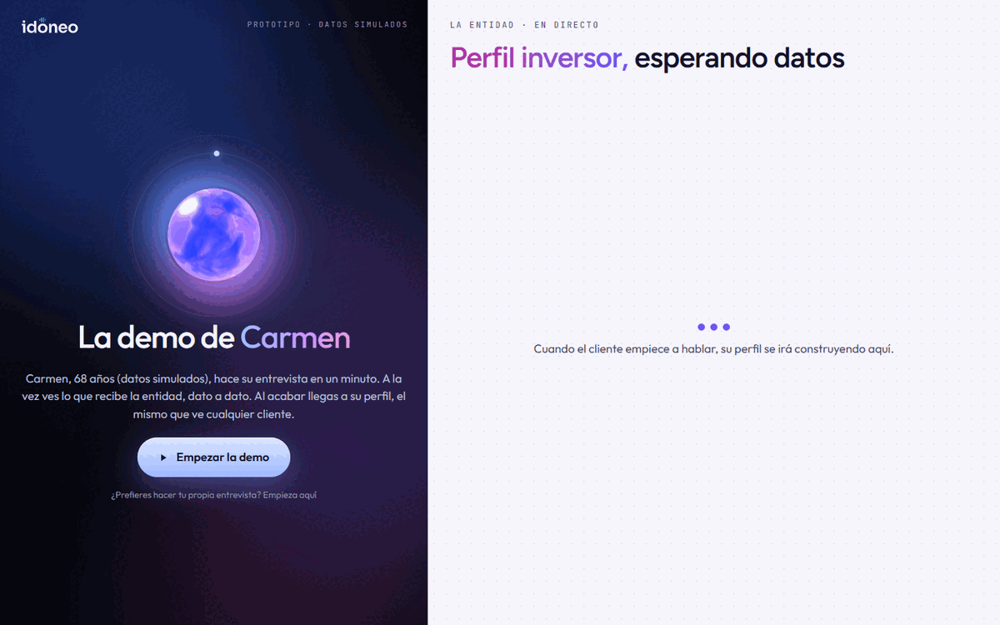</p>

## El problema

Carmen tiene 68 años y 80.000 € en depósitos. En el test de su banco marcó que conoce bien los fondos de renta variable. Pero cuando le preguntan si uno podría perder dinero, dice: *«eso no puede pasar, el fondo es del banco»*. **Marcó una cosa y demostró la contraria. El test, que se fía de lo que declara, no lo detecta.**

Antes de ofrecer un producto de inversión, la entidad tiene que evaluar si es idóneo y conveniente para el cliente (MiFID II). Hoy eso es un formulario de casillas, y el asesor no tiene tiempo de conocer a cada cliente en persona. ESMA advierte de que el riesgo de que el cliente se sobrevalore es mayor en los sistemas automatizados con poca interacción humana ([marco normativo](docs/normativa.md)).

<p align="center">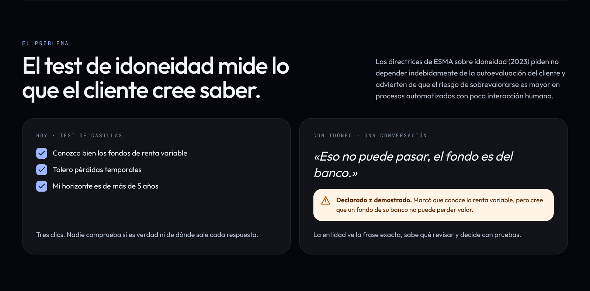</p>

## Qué hace

Tres pasos y una firma.

| | | |
|---|---|---|
| **1 · Habla** | El cliente contesta por voz o por escrito, desde el móvil, con sus palabras. | *Una conversación, no un formulario.* |
| **2 · Comprueba** | idóneo plantea escenarios y contrasta lo que dice con lo que demuestra: declaró «alto», demostró «ninguno». | *Lo que dice frente a lo que demuestra.* |
| **3 · Deja pruebas** | Cada dato queda con su frase exacta, su fuente y su minuto. Los números los calcula código, no la IA. | *Cada dato, con su prueba.* |
| **✓ Valida una persona** | El asesor recibe el perfil hecho y solo interviene si hay dudas. Hasta que lo valida, el agente no puede usarlo. | *La IA prepara; la persona decide.* |

**Qué no hace: no recomienda productos.** Da los límites que cualquier propuesta debe respetar (riesgo máximo, familias convenientes, liquidez). Qué ofrecer lo decide el agente o el asesor de la entidad.

## Dónde se integra

idóneo **no es una app**: es una función con marca propia que la entidad integra dentro de la suya. El cliente ve su banco; idóneo firma en pequeño, al pie: **Powered by idóneo**. Aparece en tres momentos:

1. **Alta del cliente** (el principal). En lugar del test, una conversación que crea un perfil real: qué sabe, cuánto puede perder y qué busca.
2. **Microentrevistas.** Antes de una compra o cuando algo cambia en su vida: «¿Ha cambiado algo?». Se pregunta solo lo que ha cambiado.
3. **Perfil vivo.** La entidad queda al día de lo que el cliente cuenta en cada conversación, sin volver a empezar de cero.

### En el móvil del cliente

<table>
<tr>
<td align="center" width="25%"><br><sub><b>1 · Entrada</b><br>La función dentro de la app</sub></td>
<td align="center" width="25%">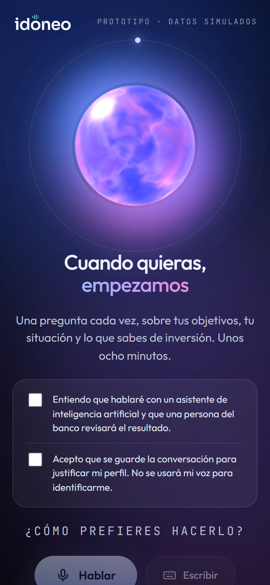<br><sub><b>2 · Entrevista</b><br>Por voz o por escrito, una pregunta cada vez</sub></td>
<td align="center" width="25%">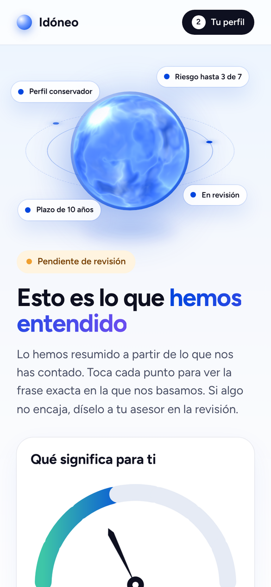<br><sub><b>3 · Su perfil</b><br>Lo que hemos entendido, con la frase de cada dato</sub></td>
<td align="center" width="25%">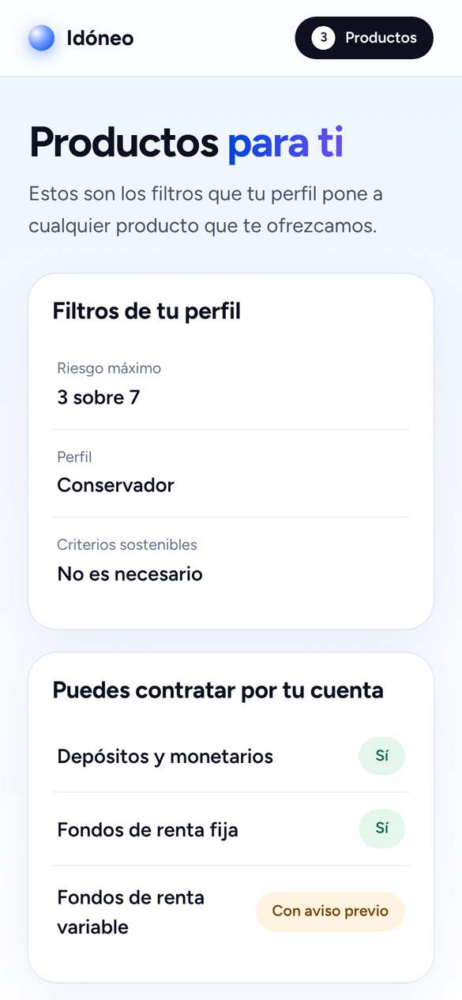<br><sub><b>4 · Sus límites</b><br>Riesgo máximo y qué familias le convienen</sub></td>
</tr>
</table>

### Lo que recibe la entidad

<table>
<tr>
<td width="50%">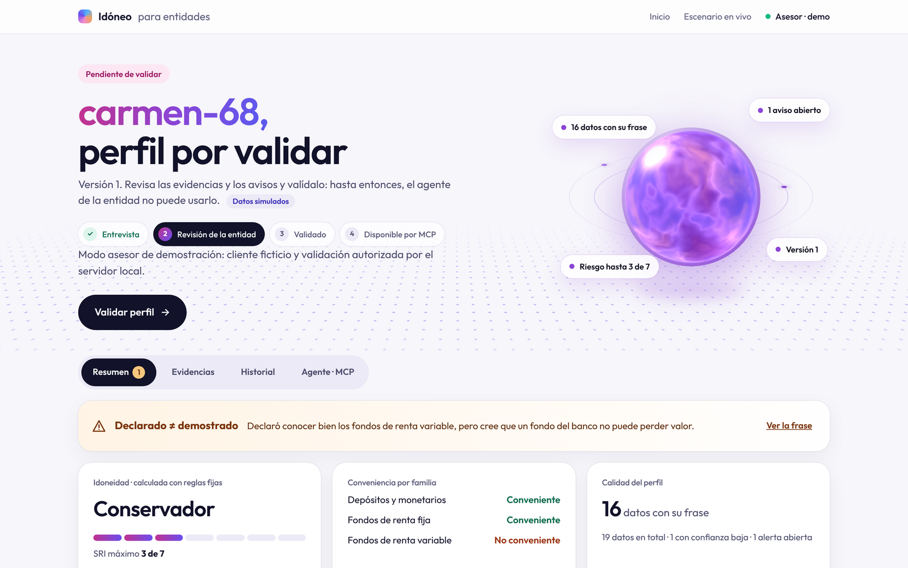<br><sub><b>Revisión.</b> El perfil hecho, con el aviso de lo declarado frente a lo demostrado y los cálculos de idoneidad y conveniencia.</sub></td>
<td width="50%">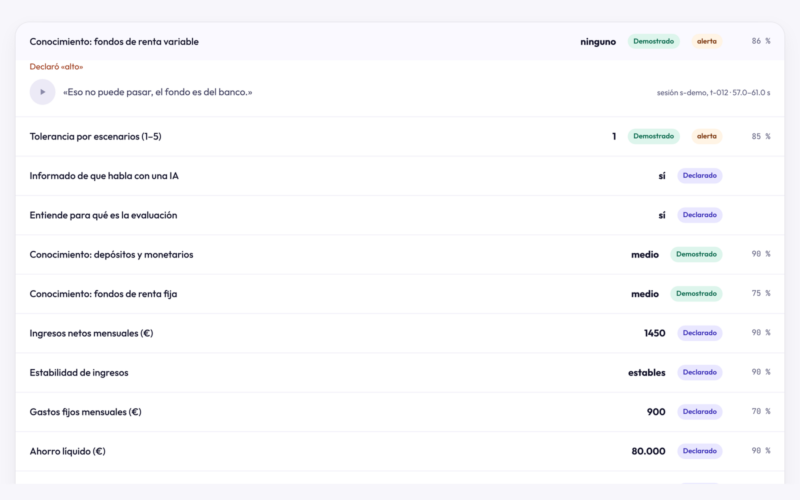<br><sub><b>Evidencias.</b> Cada dato con su fuente y su frase exacta. En las entrevistas por voz, un botón reproduce ese fragmento de la llamada.</sub></td>
</tr>
<tr>
<td width="50%">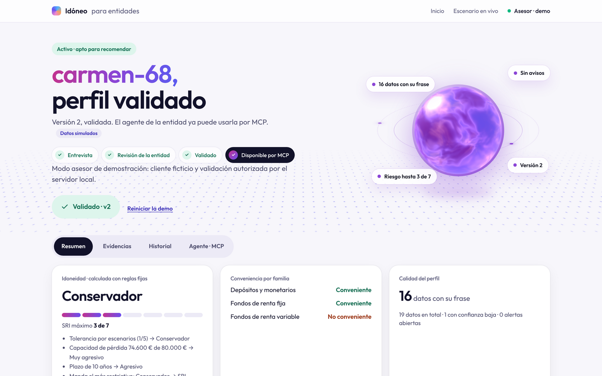<br><sub><b>Validación.</b> Una persona firma: el perfil queda activo como versión nueva.</sub></td>
<td width="50%">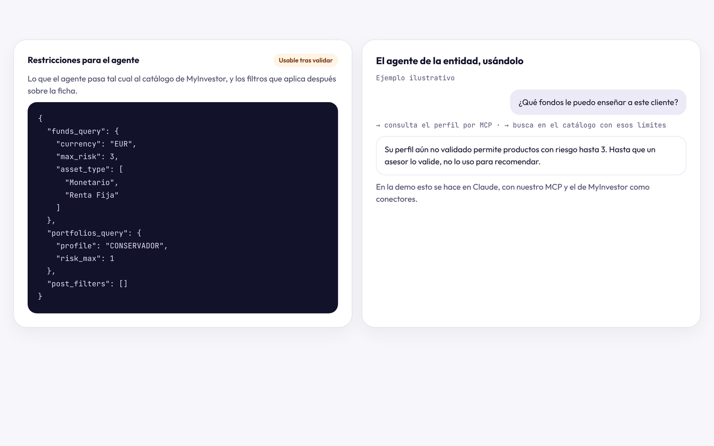<br><sub><b>Para el agente.</b> Los límites que el agente de IA de la entidad consulta por MCP antes de proponer nada.</sub></td>
</tr>
</table>

### Cuando algo cambia

Desde **Mi perfil**, el cliente pulsa **¿Ha cambiado algo en tu vida?**, elige qué ha pasado y ve al momento qué se le va a preguntar. Qué preguntar lo decide código, no la IA, con un máximo de seis preguntas. La entidad ve el antes y el después con la frase de cada cambio y vuelve a validar. Mientras tanto, su agente sigue usando la última versión validada y sabe qué datos están en revisión.

<p align="center">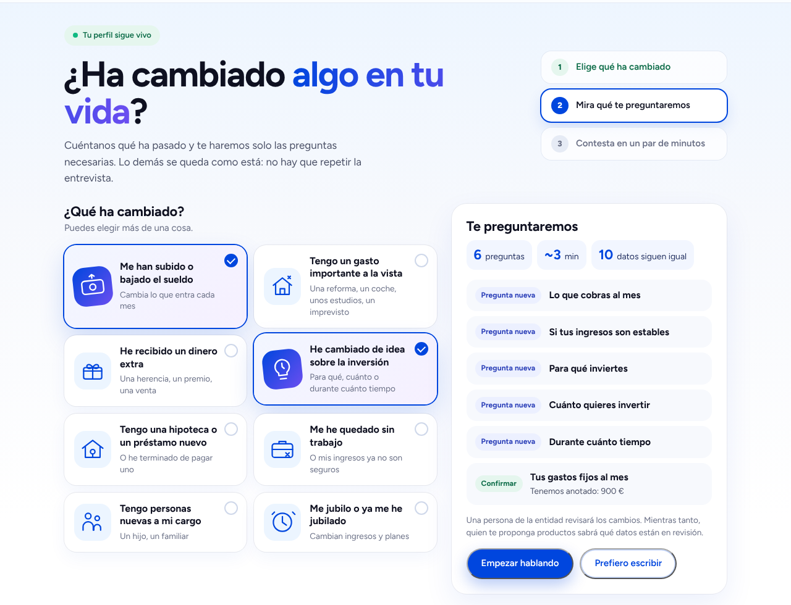</p>

## Cómo funciona

```mermaid
flowchart LR
    A["📱 Cliente<br/>voz o texto"] -->|alta| I["Entrevistador<br/>ElevenLabs (voz) · Claude (texto)"]
    A -->|"«¿Ha cambiado algo?»"| R["Planificador determinista<br/>solo lo afectado · máx. 6 preguntas"]
    R -->|microentrevista| I
    I -->|turnos| B["Agentes con Claude<br/>extractor · verificador"]
    B -->|datos con cita| C[("Perfil versionado<br/>evidencias · audio · alertas")]
    C --> D["Cálculos deterministas<br/>idoneidad · conveniencia"]
    D -.->|lo que falta| I
    D --> E{"Asesor valida<br/>antes / después"}
    E -->|perfil activo| F["API REST + servidor MCP"]
    C -.->|"datos en revisión<br/>(pending_review)"| F
    F --> G["Agente de la entidad<br/>GPTadvisor · Claude"]
    G -.->|conector en la conversación| H["Catálogo de MyInvestor"]
```

Resultado para Carmen, calculado por el backend:

| | |
|---|---|
| **Perfil de riesgo** | Conservador · riesgo máximo **3 sobre 7**. Manda el más restrictivo de tolerancia, capacidad de pérdida y plazo |
| **Conveniencia** | Depósitos y monetarios ✅ · Fondos de renta fija ✅ · Fondos de renta variable ❌ (declaró saber, no lo demostró) |
| **Límites para el agente** | `max_risk: 3`, `currency: EUR`, `asset_type: Monetario o Renta Fija` |

**Se integra con los agentes de IA de la entidad.** El backend sirve un servidor MCP propio con cuatro herramientas de solo lectura: los límites de inversión del cliente, la evidencia de cada dato, el perfil completo y un resumen para otro agente. Lo hemos ensayado con Claude y el conector público de MyInvestor: lee los límites de Carmen y busca en el catálogo real fondos compatibles en unos 16 segundos. Nuestro backend nunca llama al catálogo de MyInvestor: sus [términos](https://mcp.myinvestor.es/terms) solo permiten usarlo como conector dentro de una conversación. Cómo conectarlo: [guía del agente y el MCP](docs/modo-asesor-demo.md#recorrido-completo-del-pitch).

Más detalle: [arquitectura](docs/arquitectura.md).

## Pruébalo

### En la web, sin instalar nada

Abre **<https://hack-finance-uc3m-2026.vercel.app>**. El backend usa un plan gratuito que se duerme: la primera petición puede tardar cerca de un minuto.

1. **Ver la demo guiada** → **Empezar la demo.** La entrevista de Carmen y, al lado, su perfil construyéndose. No usa IA y está siempre disponible.
2. **Soy cliente.** Tu propia entrevista, por voz o escribiendo. Usa IA y tiene un cupo diario de pruebas. No introduzcas datos reales.
3. **Soy entidad.** La bandeja de perfiles y la validación. Pide la clave del equipo.

### En local

**Requisitos:** Python 3.11 o superior, Node.js 20 o superior y Git.

<details>
<summary><b>Instalar y arrancar (unos 10 minutos)</b></summary>

Backend, en Windows (PowerShell):

```powershell
git clone https://github.com/fernanrama/hack-finance-uc3m-2026
cd hack-finance-uc3m-2026\backend
python -m venv .venv
.venv\Scripts\activate        # si falla: Set-ExecutionPolicy -Scope Process Bypass
pip install -r requirements.txt
python scripts/preparar_demo.py
uvicorn app.main:app --port 8000
```

Backend, en macOS o Linux:

```bash
git clone https://github.com/fernanrama/hack-finance-uc3m-2026
cd hack-finance-uc3m-2026/backend
python3 -m venv .venv
source .venv/bin/activate
pip install -r requirements.txt
python scripts/preparar_demo.py
uvicorn app.main:app --port 8000
```

Frontend, en otra terminal:

```bash
cd frontend
npm install
npm run dev
```

`preparar_demo.py` crea la configuración local con secretos aleatorios, sin mostrarlos, y activa el [modo asesor de demostración](docs/modo-asesor-demo.md), que solo funciona en local y con clientes ficticios. Para hacer una entrevista nueva hacen falta además tus claves en `.env`: `ANTHROPIC_API_KEY` y, para la voz, las de ElevenLabs. Todas las variables: [docs/configuracion.md](docs/configuracion.md).

</details>

| # | Abre | Qué verás |
|:-:|---|---|
| 1 | <http://localhost:3000/escenario> → **Empezar la demo** | La entrevista de Carmen y su perfil construyéndose en directo |
| 2 | <http://localhost:3000/entidad/carmen-68> | Cada dato con su fuente y su cita, el perfil conservador y el aviso de lo declarado frente a lo demostrado |
| 3 | Pestaña **Evidencias** → **Conocimiento: fondos de renta variable** → ▶ | La prueba, con la voz de Carmen: *«Eso no puede pasar, el fondo es del banco.»* |
| 4 | Botón **Validar perfil** | El perfil queda activo y el agente de la entidad ya puede usarlo |
| 5 | **Mi perfil** → **¿Ha cambiado algo en tu vida?** | Una microentrevista con solo las preguntas afectadas, y el antes y el después en la vista de la entidad |
| 6 | <http://localhost:8000/docs> | Toda la API |

Tests, desde `backend/`: `python -m pytest -q`. Más de 1000 tests, sin claves ni red.

## Evaluación

Medido con clientes **simulados** y Claude real. Método, registro de ejecuciones y límites en [docs/evaluacion/](docs/evaluacion/README.md).

| Qué | Resultado |
|---|---|
| Extractor, en 7 entrevistas difíciles (correcciones, evasivas, terceros, manipulación) | **31 de 31 datos, 100 % de precisión y 0 datos prohibidos** |
| 20 entrevistas completas con clientes simulados | **165 de 166 datos**, 0 recomendaciones de producto, aviso de IA siempre y la alerta de lo declarado frente a lo demostrado en los 7 casos que la esperaban |
| Verificador, 8 tramos × 3 repeticiones | **0 falsas alarmas** |
| Voz de punta a punta | Probada con una entrevista por voz de 45 turnos: 15 datos con cita y la alerta clave detectada |
| Latencia y coste | Unos 2 s de mediana por respuesta · entre 0,3 y 0,45 $ por entrevista, estimado a partir de los tokens |

**Límites:** muestras pequeñas, casos escritos por el propio equipo y clientes interpretados por Claude, no por personas. Los umbrales de los cálculos son supuestos del equipo, pendientes de revisión experta.

La página `/operaciones` de la app enseña la última evaluación de cada componente frente a sus umbrales y, en vivo, la latencia y el coste estimado de cada agente. La integración continua repite las evaluaciones cuando cambian los prompts ([detalle](backend/app/ops/README.md)).

## Marco normativo

Contrastado con el texto oficial en [docs/normativa.md](docs/normativa.md): MiFID II (arts. 25.2 y 25.3), el Reglamento Delegado 2017/565 (art. 54.7), las directrices de ESMA de 2023, el RGPD (art. 22) y la Ley de IA (art. 50.1).

idóneo **recoge y documenta lo que MiFID exige, cada dato con su prueba, y lo valida una persona**. No cumple la norma por sí solo: la responsabilidad sigue siendo de la entidad.

## Qué es simulado y qué no

- **Simulado:** Carmen y el resto de clientes, sus cifras y sus entrevistas de prueba; los umbrales de los cálculos, que son supuestos del equipo; la validación del asesor en la demo local.
- **Real:** Claude como entrevistador, extractor y verificador; la voz con ElevenLabs; el servidor MCP propio; el catálogo de MyInvestor consultado por Claude a través de su conector público.

## Estado

| Pieza | Estado |
|---|---|
| Entrevista por voz y por escrito, con extractor y verificador | ✅ Hecho, con tests y evaluación |
| Perfil versionado con evidencias, pruebas de audio y validación de la entidad | ✅ Hecho, con tests |
| Idoneidad, conveniencia y límites calculados con código | ✅ Hecho · los umbrales son supuestos del equipo |
| Perfil vivo: «¿Ha cambiado algo?», microentrevista y antes y después | ✅ Hecho, con tests |
| Servidor MCP y uso desde un agente de IA | ✅ Hecho y ensayado |
| Identidad y acceso real de clientes y asesores | ⏳ Fuera del prototipo |

## Repositorio y documentación

| Ruta | Contenido |
|---|---|
| [`backend/`](backend/) | API FastAPI: perfil versionado, cálculos deterministas, agentes, servidor MCP, migraciones y tests |
| [`frontend/`](frontend/) | La función en el móvil y la vista de la entidad, con Next.js ([detalles](frontend/README.md)) |
| [`docs/`](docs/README.md) | [Arquitectura](docs/arquitectura.md), [configuración](docs/configuracion.md), [despliegue](docs/despliegue.md), [evaluación](docs/evaluacion/README.md), [marco normativo](docs/normativa.md), [agente y MCP](docs/modo-asesor-demo.md) y [marca](docs/marca/README.md) |
| [`entrega/`](entrega/) | Presentación (HTML, se abre sin internet) y resumen de una cara (PDF). Sus fuentes, en [`docs/presentacion/`](docs/presentacion/) |

<div align="center"><sub>Prototipo para Hack Finance UC3M 2026 · No es un producto oficial de ninguna entidad</sub></div>
