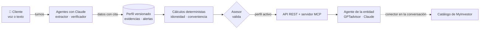

<div align="center">

# Real Betis Balompié 💚

**El test MiFID convertido en una conversación que comprueba y deja pruebas.**

Onboarding por voz, pensado primero para el móvil, que construye un **perfil inversor verificado**
y lo entrega por API y **MCP** a los agentes de la entidad.


[Probarlo en 10 minutos](#probarlo-en-10-minutos) · [Cómo funciona](#cómo-funciona) · [Usarlo desde Claude](#usarlo-desde-claude-con-myinvestor) · [Estado](#estado) · [Configuración](#configuración)

<sub>Hack Finance UC3M 2026 · Nombre provisional, el definitivo está por decidir · Todos los datos de clientes son simulados</sub>

</div>

---

<table>
<tr>
<td align="center" width="33%"><br><sub><b>1.</b> La feature dentro de la app</sub></td>
<td align="center" width="33%"><br><sub><b>2.</b> La entrevista, por voz o por escrito</sub></td>
<td align="center" width="33%"><br><sub><b>3.</b> Lo que recibe la entidad</sub></td>
</tr>
</table>

## El problema

Antes de ofrecer un producto de inversión, la entidad tiene que evaluar si es **idóneo** y **conveniente** para el cliente (MiFID II). Hoy eso es un formulario de casillas basado en lo que el cliente **dice** de sí mismo, y el cliente tiende a sobrevalorarse. No queda constancia de qué entendía de verdad.

> **Carmen, 68 años** (caso simulado), marca en el test «conozco bien los fondos de renta variable».
> Hablando con ella sale: *«Eso no puede pasar, el fondo es del banco.»*
> **Declarado ≠ demostrado.**

## Qué hacemos

| | |
|---|---|
| 🗣️ **Habla** | Entrevista por voz desde el móvil, con subtítulos y alternativa escrita. |
| 🔎 **Comprueba** | Plantea escenarios y contrasta lo declarado con lo demostrado. Avisa de las contradicciones. |
| 🧾 **Deja pruebas** | Cada dato guarda su fuente, su confianza, la cita exacta y el segundo de la grabación. Nada se sobrescribe: cada cambio es una versión nueva. |
| 🧮 **Calcula con código** | Idoneidad, conveniencia y restricciones salen de funciones deterministas, nunca del modelo. |
| 🔌 **Se integra** | El perfil se sirve por API y por MCP a GPTadvisor, a Claude con el conector de MyInvestor o al agente de cualquier entidad. |

**Qué no hacemos: no recomendamos productos.** Damos los límites que cualquier propuesta debe respetar (riesgo máximo, familias convenientes, liquidez). Qué productos ofrecer lo decide el agente de la entidad, y un asesor valida el perfil antes de que se pueda usar.

## Cómo funciona



Resultado para Carmen, calculado por el backend:

| | |
|---|---|
| **Perfil de riesgo** | CONSERVADOR · riesgo máximo **3 sobre 7**. Manda el más restrictivo de tolerancia (1/5), capacidad de pérdida y plazo |
| **Conveniencia** | Depósitos y monetarios ✅ · Fondos de renta fija ✅ · Fondos de renta variable ❌ (declaró saber, no lo demostró) |
| **Restricciones para MyInvestor** | `max_risk: 3`, `currency: EUR`, `asset_type: Monetario o Renta Fija` |

## Probarlo en 10 minutos

**Requisitos:** Python 3.11+ (probado con 3.13 y 3.14), Node.js 20+ solo para el frontend (probado con 22) y Git.

### 1. Backend

<details open>
<summary><b>Windows (PowerShell)</b></summary>

```powershell
git clone https://github.com/fernanrama/hack-finance-uc3m-2026
cd hack-finance-uc3m-2026
copy .env.example .env
cd backend
python -m venv .venv
.venv\Scripts\activate        # si falla: Set-ExecutionPolicy -Scope Process Bypass
pip install -r requirements.txt
uvicorn app.main:app --port 8000
```
</details>

<details>
<summary><b>macOS / Linux</b></summary>

```bash
git clone https://github.com/fernanrama/hack-finance-uc3m-2026
cd hack-finance-uc3m-2026
cp .env.example .env
cd backend
python3 -m venv .venv
source .venv/bin/activate
pip install -r requirements.txt
uvicorn app.main:app --port 8000
```
</details>

Sin rellenar nada del `.env` funciona todo menos la voz. Al arrancar se carga a Carmen.

### 2. Frontend (otra terminal)

```bash
cd frontend
npm install
cp .env.example .env.local      # Windows: copy .env.example .env.local
npm run dev
```

### 3. Recorrido de prueba

| # | Abre | Qué verás |
|:-:|---|---|
| 1 | http://localhost:3000 | La entrada a la feature dentro de la app |
| 2 | http://localhost:3000/onboarding/entrevista → **Ver demo guiada** | La entrevista de Carmen turno a turno, con subtítulos y barra de bloques |
| 3 | http://localhost:3000/entidad/carmen-68 | Cada dato con fuente, confianza y cita; perfil CONSERVADOR; la alerta *declarado ≠ demostrado* |
| 4 | Botón **Validar perfil** en esa vista | El perfil pasa a `active` y ya se puede usar |
| 5 | http://localhost:8000/api/clients/carmen-68/constraints | Las restricciones en el formato del catálogo de MyInvestor (`usable: true` tras validar) |
| 6 | http://localhost:8000/api/clients/carmen-68/evidence/knowledge.equity_funds | La prueba: *«Eso no puede pasar, el fondo es del banco.»*, segundos 57–61 |
| 7 | http://localhost:8000/docs | Toda la API, para probarla a mano |

Si algo se queda en un estado raro, `POST /api/demo/reset` (desde `/docs`) vuelve a cargar a Carmen como versión nueva.

### 4. Tests

```bash
cd backend
python -m pytest -q        # ~160 tests en verde; los que necesitan Postgres se omiten si no lo hay
```

## Usarlo desde Claude con MyInvestor

El backend sirve un **servidor MCP en `/mcp`** con 4 herramientas de solo lectura:

| Herramienta | Para qué |
|---|---|
| `get_investment_constraints` | Los límites que cualquier propuesta debe cumplir, en el formato del catálogo de MyInvestor |
| `get_evidence` | La cita y los segundos de la grabación que justifican un dato |
| `get_client_profile` | El perfil completo, con fuente y confianza de cada dato |
| `get_client_context` | Un resumen breve del cliente para otro agente |

Claude lo usa junto al conector público de MyInvestor: pide los límites de Carmen a nuestro servidor y busca en el catálogo real con ellos.

<details>
<summary><b>Pasos para conectarlo (túnel temporal desde el portátil)</b></summary>

1. Instala cloudflared (Windows: `winget install --id Cloudflare.cloudflared` y abre una terminal nueva) y ejecuta `cloudflared tunnel --url http://localhost:8000`. Apunta la URL `https://xxxx.trycloudflare.com`.
2. En `.env`: `MCP_ALLOWED_HOSTS=xxxx.trycloudflare.com` (sin `https://`) y un `ADMIN_TOKEN` largo y aleatorio (`python -c "import secrets; print(secrets.token_urlsafe(32))"`). Con una URL pública el token es obligatorio: protege la validación.
3. Arranca (o reinicia) el backend y valida a Carmen enviando la cabecera `X-Admin-Token`, desde `/docs` o con:
   `curl -X POST http://localhost:8000/api/clients/carmen-68/validate -H "X-Admin-Token: <token>" -H "Content-Type: application/json" -d '{"advisor_id":"asesor-demo"}'`
4. En claude.ai: **Ajustes → Conectores → Añadir conector personalizado** → `https://xxxx.trycloudflare.com/mcp`. Activa también el conector de MyInvestor (`https://mcp.myinvestor.es/mcp`).
5. En un chat nuevo: *«Busca en MyInvestor fondos que encajen con la clienta carmen-68»*.

Para que el botón «Validar perfil» del frontend funcione con el backend protegido, pon el mismo `ADMIN_TOKEN` en `frontend/.env.local`: el servidor de Next añade la cabecera y el token no llega al navegador.
</details>

**Probado el 9/11/2026:** Claude recibe por la URL pública el perfil activo de Carmen y encuentra fondos de renta fija y monetarios en EUR con riesgo ≤ 3, ninguno de renta variable. Detalles en [backend/app/mcp/README.md](backend/app/mcp/README.md).

> [!IMPORTANT]
> Nuestro backend **nunca** llama al MCP de MyInvestor: sus [términos](https://mcp.myinvestor.es/terms) solo permiten usarlo como conector dentro de una conversación.

## Estado

| Pieza | Estado |
|---|---|
| Perfil versionado, evidencias, validación de la entidad y persistencia (memoria, SQLite o Postgres) | ✅ Hecho, con tests |
| Idoneidad, conveniencia y restricciones calculadas con código | ✅ Hecho · los umbrales son **supuestos del equipo**, pendientes de revisión |
| Servidor MCP y conexión con Claude + MyInvestor | ✅ Hecho y probado con túnel |
| Frontend móvil: entrevista, demo guiada, perfil del cliente y vista de la entidad | ✅ Hecho |
| Extractor (de la conversación al perfil, con Claude) | 🟡 En desarrollo · mientras tanto el perfil de Carmen viene de un fixture simulado |
| Verificador con Claude y resumen para agentes | 🟡 Reglas deterministas hechas · versión con Claude en desarrollo |
| Voz con ElevenLabs | 🟡 Integrado en código · sin probar con cuenta real |
| Medición de impacto (aciertos, alertas, latencia, coste) | ⏳ Pendiente |

## Configuración

El `.env` va en la raíz del repo (plantilla en `.env.example`) y nunca se sube a Git. Arranca el backend desde `backend/`: las rutas relativas (`DATA_DIR=./data`) se resuelven desde ahí y `backend/data/` está ignorada por Git.

<details>
<summary><b>Variables del backend</b></summary>

Todas están en `.env.example`.

| Variable | Por defecto | Para qué |
|---|---|---|
| `PERFIL_ALMACEN` | `memoria` | `memoria` o `bd` (ver «Persistencia del perfil» más abajo) |
| `DATABASE_URL` | vacío | Solo con `bd`. La contraseña, solo en tu `.env` |
| `DATA_DIR` | `backend/data` | Carpeta de los volcados JSON (memoria) y de la base SQLite |
| `DATA_PERSIST` | `1` | `1` vuelca el almacén en memoria a `DATA_DIR`; `0` no escribe nada en disco (lo usan los tests) |
| `LOAD_DEMO_FIXTURE` | `1` | Carga a Carmen (DATOS SIMULADOS) al arrancar, solo si no existe |
| `ADMIN_TOKEN` | vacío | Si se define, `POST /validate` y `POST /api/demo/reset` exigen la cabecera `X-Admin-Token`. El front aún no la envía |
| `DEMO_ENDPOINTS` | `1` | `0` desactiva `POST /api/demo/reset` (para un despliegue público) |
| `CORS_ORIGINS` | `http://localhost:3000` | Orígenes del front permitidos, separados por comas |
| `MCP_ALLOWED_HOSTS` | vacío | Hosts públicos del MCP (túnel o despliegue) |
| `ELEVENLABS_API_KEY`, `ELEVENLABS_AGENT_ID` | vacío | Voz: el backend firma la URL; sin ellas, `/api/voice/signed-url` da 503 |
| `ANTHROPIC_API_KEY`, `MODEL_EXTRACTOR`, `MODEL_VERIFICADOR` | vacío / modelos de Claude | Para los agentes con Claude (extractor y verificador), cuando estén integrados |

Variables del frontend, en `frontend/.env.local` (plantilla en `frontend/.env.example`): `NEXT_PUBLIC_API_URL` (por defecto `http://localhost:8000`) y `NEXT_PUBLIC_ELEVENLABS_AGENT_ID` (solo si el agente de voz es público).

Variables del frontend, en `frontend/.env.local` (plantilla en `frontend/.env.example`): `NEXT_PUBLIC_API_URL` (por defecto `http://localhost:8000`) y `NEXT_PUBLIC_ELEVENLABS_AGENT_ID` (solo si el agente de voz es público).
</details>

<details>
<summary><b>Persistencia del perfil (memoria, SQLite o Postgres)</b></summary>


El backend guarda el perfil en memoria por defecto, sin base de datos. Para persistirlo:

| `PERFIL_ALMACEN` | Dónde se guarda |
|---|---|
| `memoria` (por defecto) | En memoria; con `DATA_PERSIST=1`, versiones y capa personal se vuelcan a JSON en `DATA_DIR` |
| `bd` | `DATABASE_URL`: Postgres/Supabase (Session pooler, puerto 5432), o vacío = SQLite en `backend/data/perfil.db` |

Cada cambio crea una versión nueva que nunca se modifica, y en Postgres la propia base bloquea `UPDATE`, `DELETE` y `TRUNCATE` del registro. Antes de usar Postgres o Supabase hay que aplicar las migraciones: procedimiento, comprobaciones y qué hacer si algo falla en [backend/migraciones/README.md](backend/migraciones/README.md) (desde `backend/`: `python -m app.perfil.persistencia.verificar previo`, luego `ensayo`, y `python -m app.perfil.persistencia.migrar --aplicar` solo con autorización).

Comportamiento del backend (almacenes, validación, versionado, estados, capa personal, rechazos y códigos de error): [docs/CONTRATOS.md](docs/CONTRATOS.md#backend-integrado-persistencia-validación-y-versionado).

Para repetir los tests también contra un Postgres **local y desechable** (nunca Supabase; se vacía en cada test y su nombre debe llevar `test`):

```bash
cd backend
TEST_POSTGRES_URL=postgresql://usuario@127.0.0.1:5432/perfil_test python -m pytest -q
```
</details>

## Estructura del repositorio

| Ruta | Contenido |
|---|---|
| [`backend/`](backend/) | API FastAPI: perfil versionado (`app/perfil/`), cálculos deterministas (`calculos.py`), agentes (`app/agentes/`), MCP (`app/mcp/`), migraciones y tests |
| [`frontend/`](frontend/) | Feature móvil Next.js: onboarding por voz ([detalles](frontend/README.md)) |
| [`docs/`](docs/) | Idea y contrato del perfil ([docs/proyecto/](docs/proyecto/README.md)), cómo lo implementa el código ([CONTRATOS.md](docs/CONTRATOS.md)), diseño y reparto |
| [`gestion/`](gestion/) | Organización del hackathon: análisis del reto, pitch, demo y archivo |

<div align="center"><sub>Prototipo para Hack Finance UC3M 2026 · No es un producto oficial de ninguna entidad · Datos simulados</sub></div>
