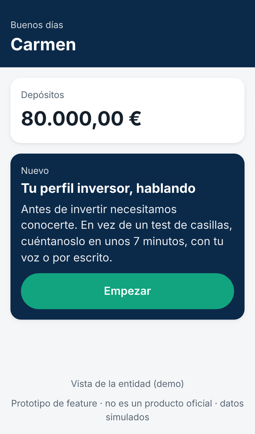
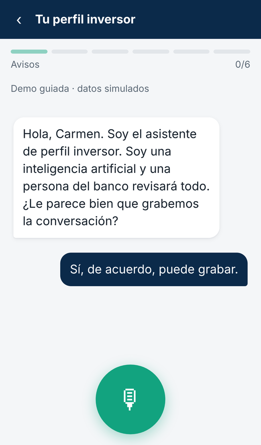
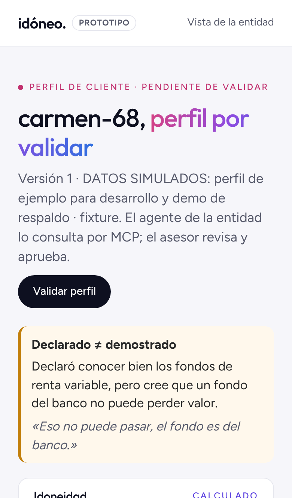
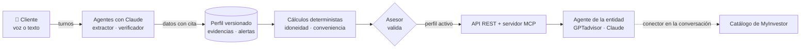

<div align="center">

# Idóneo

**El test MiFID convertido en una conversación que comprueba y deja pruebas.**

Onboarding por voz, pensado primero para el móvil, que construye un **perfil inversor verificado**
y lo entrega por API y **MCP** a los agentes de la entidad.


[Cómo funciona](#cómo-funciona) · [Probarlo en 10 minutos](#probarlo-en-10-minutos) · [Claude + MyInvestor](#usarlo-desde-claude-con-myinvestor) · [Evaluación](#evaluación) · [Marco normativo](#marco-normativo) · [Estado](#estado)

<sub>Hack Finance UC3M 2026 · Prototipo con datos simulados</sub>

</div>

---

<table>
<tr>
<td align="center" width="33%"><br><sub><b>1.</b> La feature dentro de la app</sub></td>
<td align="center" width="33%"><br><sub><b>2.</b> La entrevista, por voz o por escrito</sub></td>
<td align="center" width="33%"><br><sub><b>3.</b> Lo que recibe la entidad</sub></td>
</tr>
</table>

## El problema

Antes de ofrecer un producto de inversión, la entidad tiene que evaluar si es **idóneo** y **conveniente** para el cliente (MiFID II). Hoy eso es un formulario de casillas basado en lo que el cliente **dice** de sí mismo, y el cliente tiende a sobrevalorarse. No queda constancia de qué entendía de verdad. ESMA lo advierte expresamente: el riesgo de sobrevaloración es mayor en los sistemas automatizados con poca interacción humana ([marco normativo](docs/normativa.md)).

> **Carmen, 68 años** (caso simulado), marca en el test «conozco bien los fondos de renta variable».
> Hablando con ella sale: *«Eso no puede pasar, el fondo es del banco.»*
> **Declarado ≠ demostrado.**

## Qué hacemos

| | |
|---|---|
| 🗣️ **Habla** | Entrevista por voz desde el móvil, con subtítulos y alternativa escrita. |
| 🔎 **Comprueba** | Plantea escenarios y contrasta lo declarado con lo demostrado. Avisa de las contradicciones. |
| 🧾 **Deja pruebas** | Cada dato guarda su fuente, su confianza, la cita exacta y el segundo de la grabación. Nada se sobrescribe: cada cambio es una versión nueva. |
| 🧮 **Calcula con código** | Idoneidad, conveniencia y restricciones salen de funciones deterministas, nunca del modelo. |
| 🔌 **Se integra** | El perfil se sirve por API y por MCP a GPTadvisor, a Claude con el conector de MyInvestor o al agente de cualquier entidad. |

**Qué no hacemos: no recomendamos productos.** Damos los límites que cualquier propuesta debe respetar (riesgo máximo, familias convenientes, liquidez). Qué productos ofrecer lo decide el agente de la entidad, y un asesor valida el perfil antes de que se pueda usar.

Visión propuesta: [evolución hacia un perfil continuo](docs/diseno/05-perfil-continuo.md), desde la entrevista inicial hasta microentrevistas adaptativas y comprobaciones solicitadas por agentes autorizados. Estas dos últimas fases son hoja de ruta; el documento distingue las piezas implementadas de lo pendiente.

## Cómo funciona



Resultado para Carmen, calculado por el backend:

| | |
|---|---|
| **Perfil de riesgo** | CONSERVADOR · riesgo máximo **3 sobre 7**. Manda el más restrictivo de tolerancia (1/5), capacidad de pérdida y plazo |
| **Conveniencia** | Depósitos y monetarios ✅ · Fondos de renta fija ✅ · Fondos de renta variable ❌ (declaró saber, no lo demostró) |
| **Restricciones para MyInvestor** | `max_risk: 3`, `currency: EUR`, `asset_type: Monetario o Renta Fija` |

## Probarlo en 10 minutos

**Requisitos:** Python 3.11+ (probado con 3.13 y 3.14), Node.js 20+ solo para el frontend (probado con 22) y Git.

### 1. Backend

<details open>
<summary><b>Windows (PowerShell)</b></summary>

```powershell
git clone https://github.com/fernanrama/hack-finance-uc3m-2026
cd hack-finance-uc3m-2026\backend
python -m venv .venv
.venv\Scripts\activate        # si falla: Set-ExecutionPolicy -Scope Process Bypass
pip install -r requirements.txt
python scripts/preparar_demo.py   # crea .env y frontend/.env.local con secretos locales aleatorios
uvicorn app.main:app --port 8000
```
</details>

<details>
<summary><b>macOS / Linux</b></summary>

```bash
git clone https://github.com/fernanrama/hack-finance-uc3m-2026
cd hack-finance-uc3m-2026/backend
python3 -m venv .venv
source .venv/bin/activate
pip install -r requirements.txt
python scripts/preparar_demo.py   # crea .env y frontend/.env.local con secretos locales aleatorios
uvicorn app.main:app --port 8000
```
</details>

`preparar_demo.py` crea los dos ficheros de configuración, genera los secretos locales que el backend exige para crear clientes (sin mostrarlos ni cambiar los que ya existan) y activa el [modo asesor de demostración](docs/modo-asesor-demo.md), que solo funciona en local y con clientes ficticios. Con eso funciona todo el recorrido de abajo. Para una entrevista nueva hacen falta además tus claves, puestas a mano en `.env`: `ANTHROPIC_API_KEY` (entrevista por escrito y extracción del perfil) y las de ElevenLabs (voz). Al arrancar se carga a Carmen (DATOS SIMULADOS).

### 2. Frontend (otra terminal)

```bash
cd frontend
npm install
npm run dev
```

### 3. Recorrido de prueba

| # | Abre | Qué verás |
|:-:|---|---|
| 1 | http://localhost:3000 | La entrada a la feature dentro de la app |
| 2 | http://localhost:3000/onboarding/entrevista → **Ver demo guiada** | La entrevista de Carmen turno a turno, con subtítulos y barra de bloques |
| 3 | http://localhost:3000/entidad/carmen-68 | Cada dato con fuente, confianza y cita; perfil CONSERVADOR; la alerta *declarado ≠ demostrado* |
| 4 | Botón **Validar perfil** en esa vista (lo habilita el [modo asesor de demostración](docs/modo-asesor-demo.md), que `preparar_demo.py` deja activado) | El perfil pasa a `active` y ya se puede usar |
| 5 | Bloque **Restricciones para el agente** de esa vista | Las restricciones en el formato del catálogo de MyInvestor, utilizables tras validar. La API (`/api/clients/…`) exige la credencial del cliente; sin ella, http://localhost:8000/api/demo/constraints enseña el formato con la Carmen de muestra, sin validar |
| 6 | En esa vista, el dato **Fondos de renta variable** | La prueba: *«Eso no puede pasar, el fondo es del banco.»*, segundos 57–61 |
| 7 | http://localhost:8000/docs | Toda la API, para probarla a mano |

Si algo se queda en un estado raro, **Reiniciar la demo** en esa vista (con el modo asesor de demostración) o `POST /api/demo/reset` con `X-Admin-Token` (desde `/docs`) vuelven a cargar a Carmen como versión nueva.

### 4. Tests

```bash
cd backend
python -m pytest -q        # más de 600 tests en verde, sin claves ni red; los que necesitan Postgres o las dependencias del frontend se omiten si faltan
```

## Usarlo desde Claude con MyInvestor

El backend sirve un **servidor MCP en `/mcp`** con 4 herramientas de solo lectura:

| Herramienta | Para qué |
|---|---|
| `get_investment_constraints` | Los límites que cualquier propuesta debe cumplir, en el formato del catálogo de MyInvestor |
| `get_evidence` | La cita y los segundos de la grabación que justifican un dato |
| `get_client_profile` | El perfil completo, con fuente y confianza de cada dato |
| `get_client_context` | Un resumen breve del cliente para otro agente |

Claude lo usa junto al conector público de MyInvestor: pide los límites de Carmen a nuestro servidor y busca en el catálogo real con ellos.

<details>
<summary><b>Pasos para conectarlo</b></summary>

Todo en el portátil, con Claude Code y sin túneles. **Nunca** pongas `ADMIN_TOKEN` en un conector.

1. En `.env`: `DEMO_ADVISOR_MODE=1`, `DEMO_ADVISOR_TOKEN` y `MCP_DEMO_TOKEN` con valores aleatorios distintos, generados sin mostrarlos en pantalla (comandos en la guía). En `frontend/.env.local`, el mismo `DEMO_ADVISOR_TOKEN`. Reinicia.
2. Valida a Carmen en `http://localhost:3000/entidad/carmen-68`, o entrevista a un cliente ficticio nuevo y pide al operador que lo autorice con `python scripts/demo_operador.py autorizar <client_id> --confirmo-ficticio`.
3. Exporta el token en la terminal sin mostrarlo (`IDONEO_MCP_TOKEN`, ver la guía) y conecta Claude Code con **comillas simples**, para que guarde la referencia y no el token: `claude mcp add --transport http idoneo http://localhost:8000/mcp -H 'Authorization: Bearer ${IDONEO_MCP_TOKEN}'` y `claude mcp add --transport http myinvestor https://mcp.myinvestor.es/mcp`.
4. En el chat: *«Usa Idóneo para leer las restricciones de <cliente> y busca en MyInvestor fondos compatibles»*.

Guía completa: [docs/modo-asesor-demo.md](docs/modo-asesor-demo.md#recorrido-completo-del-pitch).

`ADMIN_TOKEN` no se copia al frontend. Para que el botón «Validar perfil» funcione en la presentación local, activa el [modo asesor de demostración](docs/modo-asesor-demo.md); no funciona a través de un túnel ni de un despliegue público.
</details>

**Ensayado el 11/11/2026 (E-09):** Claude Code, con los conectores `idoneo` y `myinvestor`, lee las restricciones de Carmen y la evidencia que las justifica, y busca en el catálogo real fondos de renta fija y monetarios en EUR con riesgo ≤ 3, ninguno de renta variable, en unos 16 s. Detalles en [backend/app/mcp/README.md](backend/app/mcp/README.md).

> [!IMPORTANT]
> Nuestro backend **nunca** llama al MCP de MyInvestor: sus [términos](https://mcp.myinvestor.es/terms) solo permiten usarlo como conector dentro de una conversación.

## Evaluación

Medido con clientes **simulados** y Claude real (`claude-sonnet-5-5`). Detalle, método y límites en [docs/evaluacion/](docs/evaluacion/README.md).

| Qué | Resultado |
|---|---|
| Extractor: 7 entrevistas difíciles (correcciones, evasivas, terceros, manipulación) | **100 % de cobertura, 100 % de precisión, 0 datos prohibidos** |
| 20 entrevistas completas con clientes simulados (4 personas × 2 y 12 generados al azar) | **99–100 % de aciertos**, 0 recomendaciones, aviso de IA siempre y alerta *declarado ≠ demostrado* en todos los casos que la esperaban |
| Verificador: 8 tramos × 3 repeticiones | **0 falsas alarmas** |
| Latencia y coste | Unos 2 s por llamada · unos 0,3–0,4 $ por entrevista (estimado a partir de los tokens) |
| Tests automáticos | Más de 600, sin claves ni red |

**Límites:** muestras pequeñas, casos escritos por el propio equipo y clientes interpretados por Claude, no por personas. Los umbrales de los cálculos son supuestos del equipo, pendientes de revisión experta.

## Marco normativo

Contrastado con el texto oficial (EUR-Lex, BOE y ESMA) en [docs/normativa.md](docs/normativa.md):

- **MiFID II, arts. 25.2 y 25.3:** idoneidad y conveniencia. Idóneo recoge los datos de los dos test.
- **Reglamento Delegado 2017/565, art. 54.7:** la entidad debe asegurar que la información del cliente es fiable y coherente. Es la base directa de Idóneo.
- **Directrices de ESMA de 2023 (párr. 46 y 52):** contrastar la autoevaluación con criterios objetivos, sobre todo en los sistemas automatizados.
- **RGPD, art. 22:** un asesor valida el perfil. Ninguna decisión es solo automatizada.
- **Ley de IA, art. 50.1:** el aviso de IA se da al empezar la entrevista.

Idóneo no «cumple MiFID» por sí solo: ayuda a la entidad a recoger y documentar la evaluación, y la responsabilidad sigue siendo de la entidad.

## Estado

| Pieza | Estado |
|---|---|
| Perfil versionado, evidencias, validación de la entidad y persistencia (memoria, SQLite o Postgres) | ✅ Hecho, con tests |
| Idoneidad, conveniencia y restricciones calculadas con código | ✅ Hecho · los umbrales son **supuestos del equipo**, pendientes de revisión |
| Servidor MCP y conexión con Claude + MyInvestor | ✅ Hecho · exige credencial; para la demo, Claude Code en local con `MCP_DEMO_TOKEN` ([guía](docs/modo-asesor-demo.md)) · ensayado el 11/11 (E-09) |
| Frontend móvil: entrevista, demo guiada, perfil del cliente y vista de la entidad | ✅ Hecho · «Validar perfil» con el modo asesor de demostración (PR #25) · entrevista corta del pitch sobre `carmen-corta` |
| Extractor (de la conversación al perfil, con Claude) y entrevistador en modo texto | ✅ Hecho, con tests (Claude simulado) · prueba con la API real: `python scripts/probar_extractor.py` · arquitectura en [`backend/app/agentes/`](backend/app/agentes/README.md) |
| Verificador (incoherencias, datos dudosos y casos para el asesor) | ✅ Reglas fijas + revisión con Claude, con tests (Claude simulado) · evaluación con la API real: `python scripts/evaluar_verificador.py` · el resumen para agentes sigue siendo una plantilla fija |
| Voz con ElevenLabs | ✅ Probada de punta a punta con cuenta real (E-03) · prompt del agente sincronizado con `scripts/sincronizar_voz.py` · demo guiada con audios grabados con ElevenLabs |
| Memoria personal por usuario | ✅ Consentida, versionada, borrable y proyectada a ElevenLabs · falta identidad/login real |
| Medición de impacto (aciertos, alertas, latencia, coste) | ✅ Con clientes **simulados**: 20 entrevistas completas con 99–100 % de aciertos y 0 datos inventados; verificador con 0 falsas alarmas · [evaluación](docs/evaluacion/README.md) |

## Configuración

**Producción** (Vercel + Render + Supabase, con topes de gasto): [docs/despliegue.md](docs/despliegue.md).

El `.env` va en la raíz del repo (plantilla en `.env.example`) y nunca se sube a Git. Arranca el backend desde `backend/`: las rutas relativas (`DATA_DIR=./data`) se resuelven desde ahí y `backend/data/` está ignorada por Git.

<details>
<summary><b>Variables del backend</b></summary>

Todas están en `.env.example`.

| Variable | Por defecto | Para qué |
|---|---|---|
| `PERFIL_ALMACEN` | `memoria` | `memoria` o `bd` (ver «Persistencia del perfil» más abajo) |
| `DATABASE_URL` | vacío | Solo con `bd`. La contraseña, solo en tu `.env` |
| `DATA_DIR` | `backend/data` | Carpeta de los volcados JSON (memoria) y de la base SQLite |
| `DATA_PERSIST` | `1` | `1` vuelca el almacén en memoria a `DATA_DIR`; `0` no escribe nada en disco (lo usan los tests) |
| `LOAD_DEMO_FIXTURE` | `1` | Carga a Carmen (DATOS SIMULADOS) al arrancar, solo si no existe |
| `ADMIN_TOKEN` | vacío | Credencial de servicio: `POST /validate` (junto con el Bearer del propietario), `POST /api/demo/reset` y consumidores del MCP. Nunca va al frontend |
| `DEMO_ADVISOR_MODE`, `DEMO_ADVISOR_TOKEN` | `0`, vacío | [Modo asesor de demostración](docs/modo-asesor-demo.md): habilita «Validar perfil» solo en local y para clientes ficticios. El mismo token en `frontend/.env.local` |
| `DEMO_ADVISOR_CLIENTS`, `DEMO_ADVISOR_ID` | `carmen-68`, `asesor-demo` | Clientes ficticios permitidos y autor de la validación en ese modo |
| `DEMO_ENDPOINTS` | `1` | `0` desactiva `POST /api/demo/reset` (para un despliegue público) |
| `CORS_ORIGINS` | `http://localhost:3000` | Orígenes del front permitidos, separados por comas |
| `MCP_ALLOWED_HOSTS` | vacío | Hosts públicos del MCP (túnel o despliegue) |
| `ELEVENLABS_API_KEY`, `ELEVENLABS_AGENT_ID` | vacío | Voz privada: el backend crea el bootstrap firmado; sin ellas usa el agente público si el front tiene ID |
| `VOICE_USER_ID_SECRET` | desarrollo local | Seudonimiza el `client_id` enviado como `userId`; debe ser aleatorio en despliegues |
| `ELEVENLABS_WEBHOOK_SECRET` | vacío | Verifica el post-call webhook; sin él la ruta responde 503 |
| `ELEVENLABS_SERVER_LOCATION` | vacío | Opcional: `us`, `global`, `eu-residency` o `in-residency`; no implica residencia contratada |
| `ALLOW_LEGACY_SIGNED_URL` | `0` | Solo compatibilidad local con la antigua ruta sin sesión; no activar en despliegues |
| `ANTHROPIC_API_KEY` | vacío | Activa el extractor, la revisión con Claude del verificador y el modo texto. Sin clave el extractor no hace nada, el verificador solo aplica sus reglas fijas y `/chat` responde 503 |
| `MODEL_EXTRACTOR`, `MODEL_ENTREVISTADOR`, `MODEL_VERIFICADOR` | `claude-sonnet-5-5` | Modelo de Claude de cada agente |
| `VERIFICADOR_CLAUDE` | `1` | `0` apaga la revisión con Claude del verificador; sus reglas fijas siguen funcionando |
| `EFFORT_EXTRACTOR`, `EFFORT_ENTREVISTADOR`, `EFFORT_VERIFICADOR` | `low` | Esfuerzo de razonamiento (`low`…`max`): más alto, más preciso y más lento |

Variables del frontend, en `frontend/.env.local` (plantilla en `frontend/.env.example`): `NEXT_PUBLIC_API_URL` (por defecto `http://localhost:8000`) y `NEXT_PUBLIC_ELEVENLABS_AGENT_ID` (solo si el agente de voz es público).
</details>

<details>
<summary><b>Persistencia del perfil (memoria, SQLite o Postgres)</b></summary>


El backend guarda el perfil en memoria por defecto, sin base de datos. Para persistirlo:

| `PERFIL_ALMACEN` | Dónde se guarda |
|---|---|
| `memoria` (por defecto) | En memoria; con `DATA_PERSIST=1`, versiones y capa personal se vuelcan a JSON en `DATA_DIR` |
| `bd` | `DATABASE_URL`: Postgres/Supabase (Session pooler, puerto 5432), o vacío = SQLite en `backend/data/perfil.db` |

Cada cambio crea una versión nueva que nunca se modifica, y en Postgres la propia base bloquea `UPDATE`, `DELETE` y `TRUNCATE` del registro. Antes de usar Postgres o Supabase hay que aplicar las migraciones: procedimiento, comprobaciones y qué hacer si algo falla en [backend/migraciones/README.md](backend/migraciones/README.md) (desde `backend/`: `python -m app.perfil.persistencia.verificar previo`, luego `ensayo`, y `python -m app.perfil.persistencia.migrar --aplicar` solo con autorización; todos exigen `--destino host:puerto/base` y no leen el `.env` por su cuenta).

Comportamiento del backend (almacenes, validación, versionado, estados, capa personal, rechazos y códigos de error): [docs/contratos.md](docs/contratos.md#backend-integrado-persistencia-validación-y-versionado).

Para repetir los tests también contra un Postgres **local y desechable** (nunca Supabase; se vacía en cada test, su nombre debe llevar `test` y la base debe estar marcada con `COMMENT ON DATABASE perfil_test IS 'idoneo:base-desechable-de-pruebas'`):

```bash
cd backend
TEST_POSTGRES_URL=postgresql://usuario@127.0.0.1:5432/perfil_test python -m pytest -q
```
</details>

## Qué es simulado y qué no

- **Simulado:** Carmen y el resto de clientes, sus cifras y sus entrevistas de prueba; los umbrales de los cálculos (supuestos del equipo); la validación del asesor en la demo (modo asesor de demostración, solo en local).
- **Real:** Claude como entrevistador, extractor y verificador; la voz con ElevenLabs; el servidor MCP propio; el catálogo de MyInvestor consultado por Claude a través de su conector público.

## Estructura del repositorio

| Ruta | Contenido |
|---|---|
| [`backend/`](backend/) | API FastAPI: perfil versionado (`app/perfil/`), cálculos deterministas (`calculos.py`), agentes (`app/agentes/`), MCP (`app/mcp/`), migraciones y tests |
| [`frontend/`](frontend/) | Feature móvil Next.js: onboarding por voz ([detalles](frontend/README.md)) |
| [`docs/`](docs/README.md) | Documentación: [arquitectura](docs/arquitectura.md), [diseño](docs/diseno/), [contrato del perfil](docs/contratos.md), [evaluación](docs/evaluacion/README.md), [marco normativo](docs/normativa.md) y [modo asesor de demostración](docs/modo-asesor-demo.md) |
| [`entrega/`](entrega/) | Material entregado: presentación (PowerPoint), resumen de una cara (PDF) y la fuente para regenerarlos |

<div align="center"><sub>Prototipo para Hack Finance UC3M 2026 · No es un producto oficial de ninguna entidad</sub></div>
