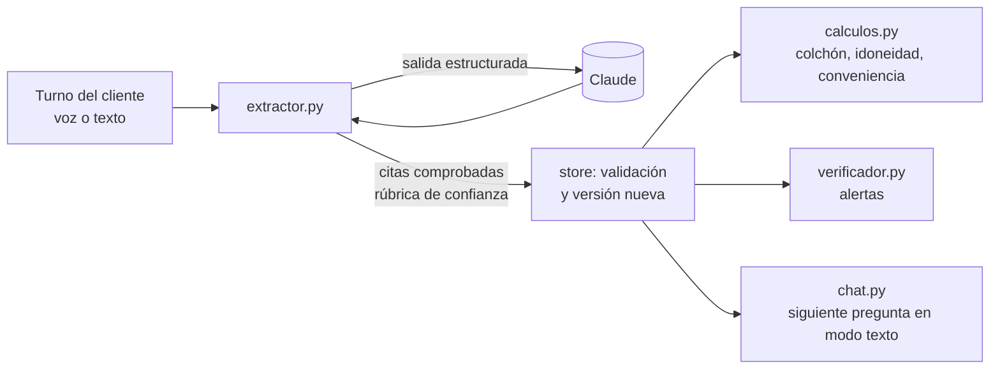

# Agentes con Claude

Los agentes **leen** la conversación; el **código decide** lo que entra en el perfil. Así los números y la confianza son reproducibles y defendibles: el modelo nunca pone una cifra calculada ni su propia opinión como confianza (contrato 04).

| Fichero | Qué hace |
|---|---|
| `claude.py` | Cliente común: modelo y esfuerzo por variable (`MODEL_<AGENTE>`, `EFFORT_<AGENTE>`), salida estructurada validada con Pydantic, reintentos del SDK y métricas de tokens y latencia por agente. Sin `ANTHROPIC_API_KEY` lanza `ClaudeNoDisponible`. |
| `rubrica.py` | Rúbrica de confianza v1, determinista y versionada. El modelo solo clasifica en categorías cerradas; aquí se fijan el nivel demostrado, la confianza y el umbral de `low_confidence` (0,65). Los números son **supuestos del equipo** y están explicados en el propio fichero. |
| `extractor.py` + `prompts/extractor.md` | De los últimos 6 turnos a parches del perfil. |
| `chat.py` + `prompts/entrevistador.md` | Entrevistador en modo texto (`POST /api/sessions/{id}/chat`). El mismo prompt sirve para el agente de voz de ElevenLabs. |
| `verificador.py`, `contexto.py` | Rol B2: alertas y resumen para otros agentes. |

## Qué garantiza el extractor, pase lo que pase con el modelo

1. **Nada inventado:** cada dato cita un fragmento que existe literalmente en un turno del cliente; si no, se descarta.
2. **Prueba localizable:** la evidencia lleva `turn_id` y los segundos del turno en la grabación.
3. **Confianza de rúbrica:** `confidence` y `confidence_basis` salen de `rubrica.py`.
4. **Declarado frente a demostrado:** si el cliente dice saber mucho y falla la pregunta de comprobación, el dato queda como demostrado `none`, con `declared: high` y el flag que dispara la alerta.
5. **Jerarquía:** no pisa lo que corrigió el asesor ni lo demostrado con algo solo declarado, y no reescribe lo mismo.
6. **Nada calculado:** los campos calculados ni siquiera están en el esquema que ve el modelo.

Después, `store` vuelve a validar tipos, autoría y evidencia; lo que no pasa queda en `rejections` de la sesión.

## Probarlo

- Tests, sin API: `python -m pytest -q tests/test_extractor.py tests/test_chat.py`.
- Con la API real y la entrevista simulada de Carmen: `python scripts/probar_extractor.py` desde `backend/`. Imprime aciertos por campo frente al fixture, alertas, rechazos, tokens y latencia.
