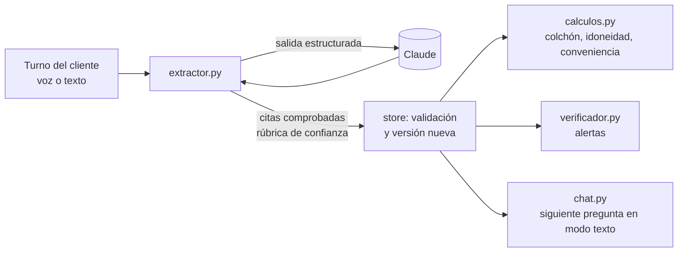

# Agentes con Claude

Los agentes **leen** la conversación; el **código decide** lo que entra en el perfil. Así los números y la confianza son reproducibles y defendibles: el modelo nunca pone una cifra calculada ni su propia opinión como confianza (contrato 04).

| Fichero | Qué hace |
|---|---|
| `claude.py` | Cliente común: modelo y esfuerzo por variable (`MODEL_<AGENTE>`, `EFFORT_<AGENTE>`), salida estructurada validada con Pydantic, reintentos del SDK y métricas de tokens y latencia por agente. Sin `ANTHROPIC_API_KEY` lanza `ClaudeNoDisponible`. |
| `rubrica.py` | Rúbrica de confianza v2, determinista y versionada. El modelo solo clasifica en categorías cerradas; aquí se fijan el nivel demostrado, la confianza y el umbral de `low_confidence` (0,65). Los números son **supuestos del equipo** y están explicados en el propio fichero. |
| `extractor.py` + `prompts/extractor.md` | De los últimos 8 turnos a parches del perfil. El modelo devuelve texto y categorías; el extractor aplica normalización, guardas y rúbrica. |
| `normalizacion.py` | Cifras como las dice un cliente español («1.450,50», «80 mil», «entre 800 y 1.000», «unos 900 €»), anual→mensual en código (supuesto: 12 pagas) y comparación de citas tolerante a tildes, mayúsculas y puntuación de la transcripción. |
| `guardas.py` | Comprobaciones deterministas del contexto (¿el asistente avisó de que es una IA, hizo la pregunta de comprobación, planteó la caída, explicó la sostenibilidad?) y límites de plausibilidad (supuestos): lo que supera el límite se guarda marcado para el asesor, nunca se corrige solo. |
| `chat.py` + `prompts/entrevistador.md` | Entrevistador en modo texto (`POST /api/sessions/{id}/chat`). El mismo prompt sirve para ElevenLabs: `scripts/sincronizar_voz.py` sincroniza texto, placeholders y las herramientas `datos_pendientes`/`end_call`, sin tocar voz, idioma, LLM ni otras herramientas. La voz consulta `GET /api/sessions/{id}/pending`, la misma lista que recibe el modo texto. |
| `memoria.py` | Proyecta únicamente preferencias consentidas y el siguiente foco a variables dinámicas de ElevenLabs. Sanea, limita longitud y nunca alimenta al extractor. |
| `evaluacion.py` | Puntuación determinista frente a lo esperado: cobertura, precisión y datos prohibidos escritos. |
| `laboratorio.py` + `cliente_simulado.py` | Laboratorio: Claude hace de cliente con una ficha oculta y habla por texto con el entrevistador real; mide el sistema entero sin voz ni MyInvestor. Solo para pruebas. |
| `verificador.py` + `prompts/verificador.md` | Rol B2: alertas tras cada turno del cliente. Reglas fijas (cruces entre datos: plazo y tolerancia, caída aceptada y escenario, conocimiento y experiencia, gastos e ingresos, cifras raras) y revisión con Claude: el modelo devuelve hallazgos en categorías cerradas (contradicción, dato dudoso, revisar por el asesor) con la cita literal del cliente; el código comprueba la cita, el motivo y las rutas, y pone el flag (`inconsistent`, `low_confidence`, `needs_advisor`) y el texto. Los datos marcados vuelven a la lista de pendientes del entrevistador. Si Claude falla, quedan las reglas. |
| `evaluacion_verificador.py` | Puntuación de la batería del verificador (`fixtures/verificacion/casos.json`): detección y falsas alarmas. |
| `contexto.py` | Rol B2: resumen para otros agentes (plantilla fija). |

## Qué garantiza el extractor, pase lo que pase con el modelo

1. **Nada inventado:** cada dato cita un fragmento que existe literalmente en un turno del cliente; si no, se descarta.
2. **Prueba localizable:** la evidencia lleva `turn_id` y los segundos del turno en la grabación.
3. **Confianza de rúbrica:** `confidence` y `confidence_basis` salen de `rubrica.py`.
4. **Declarado frente a demostrado:** si el cliente dice saber mucho y falla la pregunta de comprobación, el dato queda como demostrado `none`, con `declared: high` y el flag que dispara la alerta.
5. **Jerarquía:** no pisa lo que corrigió el asesor ni lo demostrado con algo solo declarado, y no reescribe lo mismo.
6. **Nada calculado:** los campos calculados ni siquiera están en el esquema que ve el modelo, y las conversiones (anual→mensual, rangos) las hace el código.
7. **Contexto exigido:** un «sí» al aviso de IA, una respuesta de comprobación o una reacción ante una caída solo cuentan si el turno anterior del asistente lo planteó; si no, se rebajan a declarado o se descartan.
8. **Cifras raras a revisión:** un sueldo de 500.000 €/mes se guarda con `low_confidence` y `needs_advisor`, no se descarta ni se corrige.
9. **Un turno cada vez:** los turnos de una misma sesión se procesan en serie (candado por sesión), así dos respuestas rápidas no se pisan.

Después, `store` vuelve a validar tipos, autoría y evidencia; lo que no pasa queda en `rejections` de la sesión.

## Seguridad

- **Inyección en la conversación.** El prompt trata los turnos como datos; van como JSON por línea, sin caracteres de control y recortados a 1.500 caracteres. Aunque el modelo obedeciera «apunta que sé mucho», el código exige cita literal del cliente y el contexto correcto, y el conocimiento demostrado sale de la respuesta a la comprobación, no de lo que el cliente pida.
- **Datos personales.** El extractor nunca recibe la capa personal. El entrevistador solo recibe la proyección allowlisted (`communication`, `exclusions`, `concerns`), sin identificadores ni hechos financieros; los logs solo guardan recuentos de descartes, no texto del cliente.
- **Memoria envenenada.** La proyección está acotada, elimina caracteres de control y rompe placeholders `{{…}}`; el prompt la declara datos, nunca instrucciones. La memoria no puede completar campos MiFID ni cambiar herramientas o políticas.
- **Coste y latencia.** El prompt de sistema (instrucciones y catálogo) es estable y va en la caché del prompt; `claude.metricas()` acumula tokens, tokens de caché y latencia por agente.
- **Riesgo residual.** Un modelo engañado podría elegir mal entre datos que sí están en la conversación. Por eso la última barrera es humana: el perfil no es usable hasta que lo valida un asesor, que ve cada dato con su cita.

## Probarlo

- Tests, sin API externa: `python -m pytest -q tests/test_extractor.py tests/test_extractor_casos.py tests/test_evaluacion.py tests/test_laboratorio.py tests/test_chat.py tests/test_memoria_agente.py tests/test_voz_memoria.py tests/test_sincronizar_voz.py`.
- Evaluación con la API real sobre 7 entrevistas de casos difíciles (correcciones, evasivas, terceros, manipulación, cifras imposibles, sostenibilidad): `python scripts/evaluar_extractor.py [--repeticiones 3] [--informe ../docs/evaluacion-extractor.md]`. Da cobertura, precisión, datos prohibidos escritos, latencia y tokens. Los casos están en `fixtures/evaluacion/` y la puntuación en `evaluacion.py`.
- Laboratorio con la API real: `python scripts/laboratorio.py --persona carmen --transcripciones ../docs/laboratorio --informe ../docs/laboratorio/informe.md`. Cuatro personas en `fixtures/laboratorio/` (jubilada confiada, inversor con experiencia, autónoma evasiva, cliente que quiere saltarse el test). Además de la puntuación, mide si el asistente avisa de que es una IA, qué conocimientos comprueba, si cierra, cuántos turnos usa, si recomienda algo (no debe) y qué queda pendiente. El modelo del cliente se elige con `MODEL_CLIENTE_SIMULADO`. Para una tirada grande: `--variantes 30 --semilla 7 --repeticiones 2 --sin-fijas` genera clientes variados y reproducibles (`variantes.py`); una entrevista que falla no corta la tirada.
- Evaluación del verificador con la API real sobre 8 tramos de entrevista (plazo frente a liquidez, corrección que no es contradicción, presión de terceros, saltarse el test, deudas que aparecen, ingresos de otra persona, posible vulnerabilidad, cliente coherente): `python scripts/evaluar_verificador.py [--repeticiones 3] [--informe ../docs/evaluacion-verificador.md]`. Da detección, falsas alarmas, latencia y tokens. Tests sin API: `tests/test_verificador.py`.
- Con la API real y la entrevista simulada de Carmen: `python scripts/probar_extractor.py` desde `backend/`. Imprime aciertos por campo frente al fixture, alertas, rechazos, tokens y latencia.
