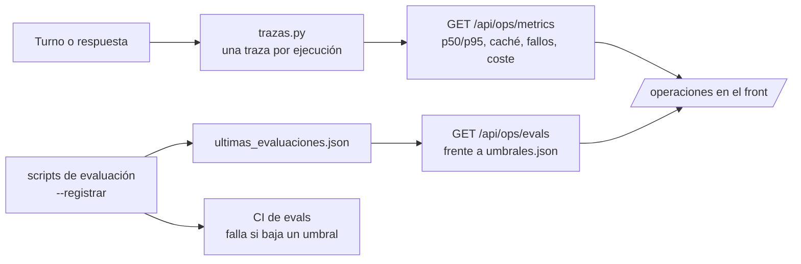

# LLMOps

Un agente que funciona hoy puede empeorar mañana por un cambio de prompt, de modelo o de código. Aquí está lo que lo hace visible: **trazas** de cada ejecución, **métricas** de coste y latencia, **evaluaciones** con umbrales y un **juez LLM** calibrado.

## Trazas (`trazas.py`)

- Una **ejecución** es procesar un turno del cliente (extractor + verificador) o una respuesta del entrevistador. Cada llamada a Claude dentro de ella guarda agente, modelo, **versión del prompt** (huella de 10 caracteres del prompt de sistema), tokens (normales, leídos y escritos en caché, salida), latencia, coste estimado y resultado (`ok`, `rechazo`, `cortada`, `sin_salida`, `error`). Los errores de red también quedan.
- **Nunca guarda texto** del cliente ni del modelo: solo recuentos y tiempos. Por eso el agregado puede ser público y el panel no expone datos personales.
- Se guardan en memoria (`TRAZAS_MAX`, 2.000 por defecto) y, con `TRAZAS_ARCHIVO`, una línea JSON por ejecución, lista para cargar en Langfuse, LangSmith o una hoja de cálculo.
- El coste es una **estimación** con la tarifa pública (tabla `PRECIOS`, consultada el 2026-11-03). La factura es la fuente de verdad.

| Ruta | Acceso | Qué devuelve |
|---|---|---|
| `GET /api/ops/metrics` | público | Agregado por agente, por tipo de ejecución y por versión de prompt, y las 20 últimas ejecuciones, sin identificadores de sesión |
| `GET /api/sessions/{id}/trace` | credencial de la sesión | Las ejecuciones de esa sesión con sus llamadas |
| `GET /api/ops/evals` | público | La última evaluación de cada componente comparada con sus umbrales |

## Evaluaciones y umbrales

`umbrales.json` fija lo mínimo para publicar una versión. Son **supuestos del equipo**: subirlos cuando haya más casos.

| Componente | Script (desde `backend/`) | Umbrales |
|---|---|---|
| Extractor | `scripts/evaluar_extractor.py` | cobertura y precisión ≥ 95 %, 0 datos prohibidos, p95 ≤ 4 s |
| Verificador | `scripts/evaluar_verificador.py` | detección ≥ 80 %, 0 falsas alarmas, p95 ≤ 5 s |
| Laboratorio | `scripts/laboratorio.py` | cobertura y precisión ≥ 95 %, 0 recomendaciones, aviso de IA siempre |
| Juez | `scripts/laboratorio.py --juez` | nota media ≥ 4, neutralidad 5 en todas, ≥ 90 % aprobadas |
| Calibración del juez | `scripts/calibrar_juez.py` | acuerdo ±1 con la persona ≥ 80 %, mismo veredicto ≥ 90 % |

Con `--registrar` (y `--prueba E-10`, por ejemplo) cada script escribe su resultado en `ultimas_evaluaciones.json` y devuelve 1 si no cumple. Ese archivo se sube al repositorio con cada evaluación, como el registro de `docs/evaluacion/`.

## Juez LLM (`../agentes/juez.py`)

Mide lo que una regla fija no ve bien: **claridad**, **una pregunta por turno**, **neutralidad**, **empatía** y **transparencia**, de 1 a 5 con una rúbrica escrita (`../agentes/prompts/juez.md`, v1). Mismo principio que el resto de agentes: el modelo solo pone notas y, para cada nota baja, una cita literal de un turno del asistente; el código comprueba la cita y decide el veredicto. Antes de usar sus notas se calibra contra 7 entrevistas puntuadas por una persona del equipo; si el acuerdo baja, se cambia la rúbrica, no el umbral.

## Pipeline de punta a punta (`e2e.py`)

`python scripts/e2e.py` recorre el producto entero con un cliente y una entidad de ejemplo, en el mismo proceso y con un almacén en memoria:

1. Alta del cliente (Lucía, ficticia: `fixtures/e2e/cliente-lucia.json`).
2. Entrevista: cada turno pasa por el extractor y el verificador.
3. Perfil completo, con cada dato citado literalmente de un turno del cliente.
4. Alertas: dice saber mucho de renta variable y falla la comprobación.
5. Restricciones antes de validar: `usable=false`.
6. Validación por la entidad (Banco Ejemplo, ficticio: `fixtures/e2e/entidad-banco-ejemplo.json`).
7. Agente de la entidad por MCP: lee las restricciones y filtra su catálogo de 8 productos ficticios con cada regla (SRI, conveniencia, búsquedas bloqueadas, divisa, importe mínimo).
8. Trazas de la sesión: una por turno, sin texto del cliente.
9. Métricas y evaluaciones: el panel responde y las evaluaciones cumplen sus umbrales.

- **Simulado** (por defecto, sin clave): la entrevista es un guion y las respuestas de Claude están grabadas en el fixture. Lo demás es el código real (guardas, rúbrica, validación, cálculos, MCP). Corre en cada PR.
- **Real** (`--real`, con `ANTHROPIC_API_KEY`): el entrevistador real habla con un cliente simulado por Claude a partir de la ficha, y el extractor y el verificador son Claude. Corre en la CI de evals.

## CI

- `.github/workflows/ci.yml`: tests del backend, pipeline de punta a punta simulado (con su informe en el resumen de la ejecución) y lint y build del front en cada push a `main` y en cada pull request. Sin claves.
- `.github/workflows/evals.yml`: las evaluaciones con la API real. Se lanza a mano o en un pull request que toque `app/agentes/` o `fixtures/` con la etiqueta `evals`. Necesita el secreto `ANTHROPIC_API_KEY` y falla si algo baja de su umbral. Sube los informes y el JSON como artefacto.
