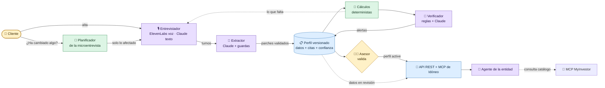
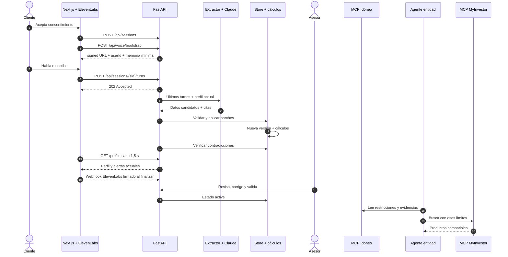
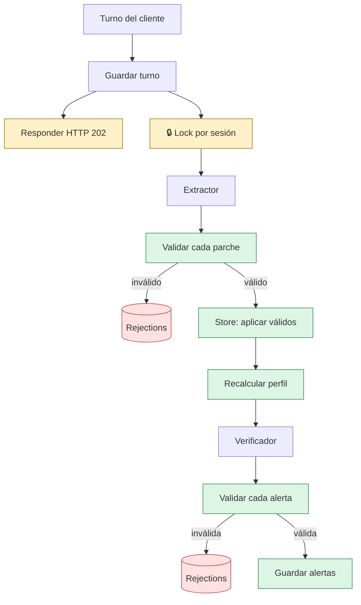
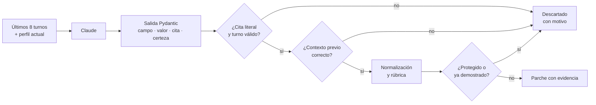
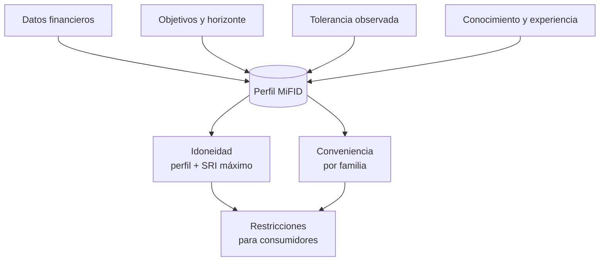
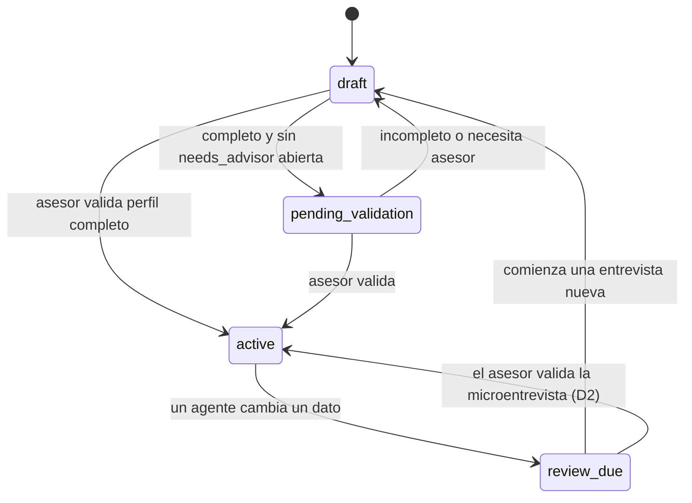
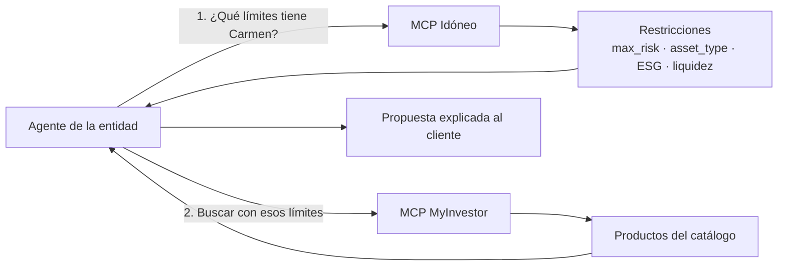

# Idóneo · Flujo de producto y arquitectura de agentes

> **Resumen ejecutivo**
> Idóneo convierte una conversación en un **perfil inversor MiFID trazable**, lo calcula con reglas reproducibles, exige una **validación humana** y lo entrega por API/MCP a los agentes de una entidad.
>
> **Idóneo no recomienda productos.** El agente de la entidad consulta las restricciones de Idóneo y las utiliza para buscar productos compatibles en MyInvestor.

---

## El producto en 30 segundos



| Símbolo | Significado |
|---|---|
| 🤖 | Un modelo interpreta lenguaje o genera conversación. |
| 🧮 | Código determinista: mismas entradas, mismo resultado. |
| 🧑‍💼 | Decisión humana necesaria para activar el perfil. |
| 🔌 | Lectura e integración con otros sistemas. |

La regla central de diseño es:

> **Los agentes leen la conversación; el código decide qué entra en el perfil.**

Esto evita que el modelo pueda inventar cálculos, asignarse su propia confianza o activar directamente un perfil. Véase [`backend/app/agentes/README.md`](../backend/app/agentes/README.md).

---

## 1. Flujo end-to-end del cliente



### Recorrido por pantallas

| Paso | Ruta | Qué ve el usuario | Qué sucede por debajo |
|---:|---|---|---|
| 1 | `/` | Entrada con aspecto de banco | Presenta la propuesta de valor. |
| 2 | `/onboarding` | Consentimiento de grabación | Todavía no se escribe el perfil. |
| 3 | `/onboarding/entrevista` | Entrevista de voz o demo guiada | Se crea una sesión y cada turno se envía al backend. |
| 4 | `/onboarding/perfil` | Objetivo, ahorro, riesgo, alertas y preferencias recordadas | Lee el perfil; permite consentir, rectificar o borrar memoria personal separada. |
| 5 | `/entidad/{client_id}` | Vista del asesor con citas y confianza | Permite validar el perfil mediante una ruta protegida del servidor de Next. |
| 6 | `/onboarding/productos` | Filtros compatibles y conveniencia | El catálogo real aún no aparece dentro de la app. |
| 7 | Claude/GPTadvisor | Conversación del agente de la entidad | Combina el MCP de Idóneo con el MCP de MyInvestor. |

### Rutas principales enlazadas

```text
/onboarding
    └── /onboarding/entrevista
            └── /onboarding/perfil
                    └── /onboarding/productos

/entidad/{client_id}   ← vista paralela para revisión humana
```

El cliente frontend de estas operaciones está en [`frontend/src/lib/api.ts`](../frontend/src/lib/api.ts). Las acciones administrativas no exponen el token en el navegador: pasan por [`frontend/src/app/api/entidad/`](../frontend/src/app/api/entidad/).

---

## 2. Qué ocurre al llegar un turno

### Pipeline interno



1. FastAPI guarda el turno y responde `202`.
2. Si habla el cliente, programa `_procesar_turno` en segundo plano.
3. Un `asyncio.Lock` por sesión evita que dos respuestas rápidas se procesen sobre versiones antiguas.
4. El extractor propone parches.
5. Cada parche se valida por separado: los válidos se guardan y los inválidos aparecen en `GET /api/sessions/{sid}` como `rejections`.
6. El store crea una versión nueva y recalcula idoneidad y conveniencia.
7. El verificador se ejecuta incluso si falló el extractor.

Código principal: [`backend/app/main.py`](../backend/app/main.py), funciones `_procesar_turno` y `_procesar_turno_sin_candado`.

> [!NOTE]
> El procesamiento es **eventual**: el perfil puede tardar un instante en reflejar el turno. Actualmente el frontend consulta `GET /profile` cada 1,5 segundos. El bus interno de eventos existe, pero el endpoint SSE sigue pendiente.

> [!WARNING]
> Los tiempos de los turnos de voz siguen siendo aproximados. El webhook de fin de llamada ya verifica HMAC, vincula `conversation_id` y cierra la sesión; reconciliar los tiempos definitivos y el audio sigue pendiente.

---

## 3. Arquitectura actual de agentes

No existe un “enjambre” autónomo. **FastAPI es el orquestador** y llama a componentes pequeños con contratos tipados.

| Componente | Tipo actual | Función | Estado |
|---|---|---|---|
| 🎙️ Agente de ElevenLabs | Modelo externo | Conduce la conversación, recibe memoria mínima por variables dinámicas y entrega transcripciones. | 🟡 Integrado y testeado con dobles; falta prueba con cuenta real. |
| 💬 `chat.py` | Claude | Genera la siguiente intervención de la entrevista textual. | 🟢 Implementado. |
| 🧠 `extractor.py` | Claude + código | Interpreta los turnos y propone datos estructurados con citas. | 🟢 Implementado. |
| 🛡️ `guardas.py` | Determinista | Comprueba que existió el contexto necesario antes de aceptar una respuesta. | 🟢 Implementado. |
| 📏 `rubrica.py` | Determinista | Asigna nivel demostrado, confianza y `low_confidence`. | 🟢 Implementado. |
| 🔎 `verificador.py` | Determinista | Genera alertas por contradicciones concretas. | 🟡 Claude pendiente. |
| 📝 `contexto.py` | Determinista | Produce un resumen corto para otros agentes. | 🟡 Claude pendiente. |
| 🏦 Agente de la entidad | Agente externo | Lee Idóneo, consulta MyInvestor y decide qué productos presentar. | 🟢 Flujo MCP disponible. |
| 🧪 Cliente simulado | Claude, solo evaluación | Representa una persona ficticia y prueba el sistema completo. | 🟢 Solo laboratorio. |
| 🧠 `memoria.py` | Determinista | Proyecta preferencias consentidas y siguiente foco sin exponer MiFID ni identificadores. | 🟢 Implementado. |

### Cliente común de Claude

[`backend/app/agentes/claude.py`](../backend/app/agentes/claude.py) centraliza:

- cliente asíncrono y perezoso;
- modelo por agente: `MODEL_EXTRACTOR`, `MODEL_ENTREVISTADOR`, etc.;
- esfuerzo por agente: `EFFORT_<AGENTE>`;
- salidas estructuradas validadas con Pydantic;
- caché del prompt de sistema;
- métricas de tokens y latencia.

Sin `ANTHROPIC_API_KEY`:

- el extractor devuelve `[]`, permitiendo que la demo con fixture siga arrancando;
- el endpoint de chat textual responde `503`.

---

## 4. Extractor: Claude propone, el código decide



Claude propone:

- el campo detectado;
- el valor o categoría;
- la certeza lingüística;
- el `turn_id`;
- una cita del cliente.

Después [`extractor.a_parches`](../backend/app/agentes/extractor.py) aplica controles que el modelo no puede saltarse:

1. El turno citado debe pertenecer al cliente y estar dentro de la ventana.
2. La cita debe existir realmente en la transcripción.
3. Números españoles, rangos y conversiones anual→mensual se resuelven con código.
4. Una respuesta solo cuenta como comprobación si el asistente hizo antes la pregunta correspondiente.
5. Un escenario de riesgo solo cuenta si previamente se planteó la caída.
6. La confianza sale de una rúbrica versionada, nunca de la opinión del modelo.
7. Una cifra implausible se conserva marcada con `low_confidence` y `needs_advisor`; no se corrige ni se oculta.
8. Nunca se pisa una corrección del asesor.
9. Lo demostrado prevalece sobre lo meramente declarado.
10. Los campos calculados no aparecen en el esquema que recibe Claude.

### Ejemplo: declarado frente a demostrado

```text
Cliente: “Conozco perfectamente los fondos de renta variable”.
Asistente: plantea una pregunta sencilla de comprobación.
Cliente: “No puede bajar porque el fondo es del banco”.

Resultado:
  declared: high
  value: none
  source: demonstrated
  flag: declared_vs_demonstrated
  evidence: cita + turno + segundos
```

Cada dato termina representado como un `Fact`:

```json
{
  "value": "none",
  "declared": "high",
  "source": "demonstrated",
  "confidence": 0.95,
  "confidence_basis": "rubric:knowledge.equity_funds:v2",
  "flags": ["declared_vs_demonstrated"],
  "evidence": [
    {
      "session_id": "s-…",
      "turn_id": "t-…",
      "t": [42.1, 46.8],
      "quote": "No puede bajar porque el fondo es del banco"
    }
  ]
}
```

---

## 5. Perfil, cálculos y estados

El perfil versionado es el centro del sistema:



Después de cada escritura, [`backend/app/perfil/calculos.py`](../backend/app/perfil/calculos.py) recalcula:

- meses de colchón de emergencia;
- capacidad económica de pérdida;
- perfil de riesgo y SRI máximo;
- conveniencia por familia de producto;
- filtros para fondos y carteras.

La idoneidad toma el resultado **más restrictivo** entre:

1. tolerancia observada mediante escenarios;
2. capacidad de pérdida;
3. horizonte temporal.

> [!IMPORTANT]
> Los umbrales actuales son **supuestos del equipo** y están pendientes de revisión financiera/regulatoria. El sistema los ejecuta de forma reproducible, pero eso no los convierte por sí solo en una fórmula oficial.

### Ciclo de vida



Abrir una revisión del cliente («¿Ha cambiado algo?») no cambia el estado (R1): solo deja una versión de trámite con los mismos datos.

| Estado | Significado | ¿Puede usarse para recomendar? |
|---|---|:---:|
| `draft` | Entrevista en curso o información insuficiente. | ❌ |
| `pending_validation` | Perfil completo, pendiente del asesor. | ❌ |
| `active` | Revisado y validado por la entidad. | ✅ |
| `review_due` | Un cambio exige una nueva revisión. | ❌ |

`GET /api/clients/{id}/profile` devuelve la última versión aunque aún no esté activa, porque el frontend la necesita durante la entrevista. Las restricciones, el contexto y el MCP prefieren el último perfil `active`; si no existe, devuelven el último con `usable: false`.

---

## 6. Revisión humana

La vista `/entidad/{client_id}` enseña al asesor:

- valor actual y valor declarado, si difieren;
- fuente: `declared`, `demonstrated`, `calculated` o `advisor`;
- confianza y su rúbrica;
- citas y tiempos de evidencia;
- alertas abiertas;
- explicación de idoneidad y conveniencia;
- restricciones que recibirá el agente externo.

Al validar:

1. las correcciones opcionales se guardan con fuente `advisor`;
2. las alertas abiertas se marcan como resueltas;
3. se registra quién y cuándo validó;
4. se fija la próxima fecha de revisión;
5. el perfil pasa a `active` únicamente si está completo.

Esta es la última barrera frente a una interpretación incorrecta del modelo.

---

## 7. Salida por API y MCP

El servidor MCP de Idóneo, montado en `/mcp`, ofrece cuatro herramientas de solo lectura:

| Herramienta | Para qué sirve |
|---|---|
| `get_client_profile` | Perfil completo, fuentes, confianza, evidencias, resultados y alertas. |
| `get_investment_constraints` | Límites listos para buscar fondos/carteras y filtros posteriores. |
| `get_evidence` | Prueba literal y temporal de un campo, o inputs si es calculado. |
| `get_client_context` | Resumen breve para orientar a otro agente. |

### Relación con MyInvestor



> [!CAUTION]
> El backend y el frontend de Idóneo **no llaman directamente al MCP de MyInvestor**. La consulta ocurre dentro de la conversación del agente externo. La página `/onboarding/productos` muestra actualmente los filtros, no un catálogo real.

---

## 8. Mapa rápido de rutas REST

| Método y ruta | Función |
|---|---|
| `POST /api/sessions` | Crear cliente si hace falta y abrir sesión. |
| `POST /api/sessions/{sid}/turns` | Guardar turno y lanzar extractor/verificador. |
| `POST /api/sessions/{sid}/chat` | Entrevista textual dirigida por Claude. |
| `GET /api/sessions/{sid}` | Turnos y rechazos de agentes. |
| `GET/PUT/DELETE /api/sessions/{sid}/memory` | Leer, consentir/rectificar y borrar memoria personal. |
| `GET /api/clients/{cid}/profile` | Última versión o versión concreta. |
| `GET /api/clients/{cid}/versions` | Historial de versiones. |
| `POST /api/clients/{cid}/validate` | Corrección y validación por la entidad. |
| `GET /api/clients/{cid}/constraints` | Restricciones para consumidores. |
| `GET /api/clients/{cid}/evidence/{path}` | Evidencias de un campo. |
| `GET /api/clients/{cid}/context` | Resumen para otro agente. |
| `POST /api/voice/bootstrap` | URL privada + ID opaco + variables dinámicas mínimas. |
| `POST /api/webhooks/elevenlabs` | Verificar el evento post-llamada y cerrar la sesión. |
| `POST /api/demo/reset` | Nueva versión del fixture simulado de Carmen. |
| `/mcp` | Servidor MCP de Idóneo. |

---

## 9. Estado actual: hecho, parcial y pendiente

| Área | Estado | Observación |
|---|:---:|---|
| Perfil versionado y evidencias | 🟢 | Implementado con memoria, SQLite o Postgres. |
| Idoneidad, conveniencia y restricciones | 🟢 | Deterministas; umbrales pendientes de revisión. |
| Extractor con Claude | 🟢 | Salida estructurada, citas, guardas y rúbrica. |
| Entrevistador textual | 🟢 | Disponible mediante `/chat`. |
| MCP de Idóneo | 🟢 | Cuatro herramientas de solo lectura. |
| Flujo Claude + MyInvestor | 🟢 | La integración ocurre como conectores del agente externo. |
| Frontend móvil y vista de entidad | 🟢 | Entrevista, perfil, revisión y demo guiada. |
| Voz ElevenLabs | 🟡 | Integrada en código; falta validar con cuenta real. |
| Memoria personal | 🟢 | Consentida, versionada, borrable y separada de MiFID. |
| Verificador con Claude | 🟡 | Hoy solo tiene reglas deterministas. |
| Resumen con Claude | 🟡 | Hoy es una plantilla determinista. |
| SSE en tiempo real | ⚪ | El frontend sigue usando polling. |
| Webhook y tiempos definitivos de voz | 🟡 | HMAC, idempotencia y cierre hechos; reconciliar tiempos/audio pendiente. |
| Productos reales dentro de la UI | ⚪ | La app muestra filtros; la búsqueda vive en el agente externo. |
| Medición final de impacto | ⚪ | Pendiente consolidar precisión, alertas, coste y latencia. |

### Riesgos que conviene poder explicar en la demo

- Los tiempos de evidencia de voz son aproximados hasta implementar el webhook.
- El frontend se actualiza mediante polling, no SSE.
- Los umbrales financieros son supuestos explícitos del MVP.
- El perfil solo debe consumirse cuando `usable: true`.
- Las lecturas y el MCP aún no tienen autenticación; una exposición pública debe usar datos simulados.
- El verificador “con Claude” y el resumen inteligente son evolución, no funcionalidad actual.

---

## 10. Dónde tocar cada comportamiento

| Si quieres cambiar… | Archivo principal |
|---|---|
| La conversación o sus preguntas | [`backend/app/agentes/prompts/entrevistador.md`](../backend/app/agentes/prompts/entrevistador.md) |
| Qué extrae Claude | [`backend/app/agentes/extractor.py`](../backend/app/agentes/extractor.py) |
| Cómo se entienden cifras y citas | [`backend/app/agentes/normalizacion.py`](../backend/app/agentes/normalizacion.py) |
| Qué contexto previo se exige | [`backend/app/agentes/guardas.py`](../backend/app/agentes/guardas.py) |
| Confianza y conocimiento demostrado | [`backend/app/agentes/rubrica.py`](../backend/app/agentes/rubrica.py) |
| Alertas del verificador | [`backend/app/agentes/verificador.py`](../backend/app/agentes/verificador.py) |
| Campos, fuentes, flags y estados | [`backend/app/perfil/modelos.py`](../backend/app/perfil/modelos.py) |
| Escritura, versionado y validación | [`backend/app/perfil/store.py`](../backend/app/perfil/store.py) |
| Idoneidad y restricciones | [`backend/app/perfil/calculos.py`](../backend/app/perfil/calculos.py) |
| Orquestación y rutas REST | [`backend/app/main.py`](../backend/app/main.py) |
| Herramientas MCP | [`backend/app/mcp/servidor.py`](../backend/app/mcp/servidor.py) |
| Entrevista del frontend | [`frontend/src/lib/useEntrevista.ts`](../frontend/src/lib/useEntrevista.ts) |
| Pantallas y navegación | [`frontend/src/app/`](../frontend/src/app/) |

---

## Mensaje final para explicar Idóneo

> **GPTadvisor o Claude hacen fiable la recomendación. Idóneo hace fiable el perfil sobre el que se recomienda.**
> La IA entiende la conversación; el código aporta reproducibilidad; las evidencias aportan trazabilidad; y el asesor mantiene el control final.

---

<sub>Documento basado en `main`, commit `e2bac3c1751b63ba2ac52d424595f727e7470667`. Describe el estado implementado del código, diferenciándolo de la hoja de ruta.</sub>
