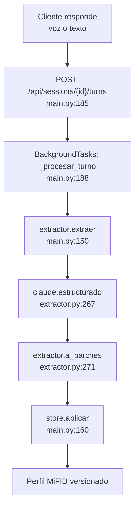
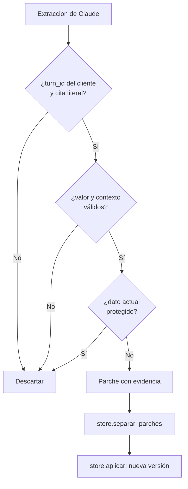
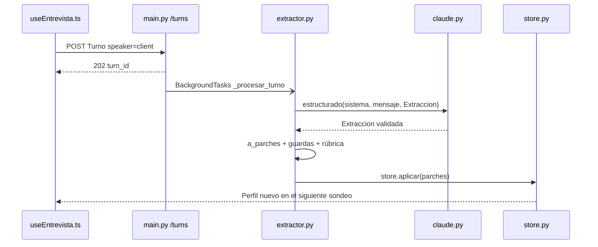

# Claude + extractor: propósito y fase del flujo

## Orientación

**Código revisado:** `/Users/pablocpz/Desktop/hack-finance-uc3m-2026` 
**Rama:** `feat/personal-memory-elevenlabs-harness`, en el mismo commit que `origin/main`, con cambios locales todavía sin commit.

Aquí intervienen tres piezas distintas: el entrevistador conversa, Claude interpreta lenguaje natural y el extractor convierte esa interpretación en cambios seguros del perfil. La idea más importante es que **“Claude + extractor” no es otro chatbot ni una fase final**: es el procesamiento interno que se ejecuta después de cada turno del cliente.

## 1. Claude: el lector probabilístico

Claude no escribe directamente en el perfil. Es el modelo que lee los últimos turnos y devuelve un objeto `Extraccion` con campos candidatos, el turno del que salen y una cita literal. La llamada común vive en `backend/app/agentes/claude.py:115`; el extractor la invoca en `backend/app/agentes/extractor.py:267`.

La salida está restringida por modelos Pydantic: `DatoExtraido`, `ConocimientoExtraido`, `EscenarioExtraido` y `Extraccion` (`backend/app/agentes/extractor.py:54-84`). Así Claude hace el trabajo que necesita comprensión semántica, por ejemplo reconocer que “cobro unos mil cuatrocientos al mes” habla de ingresos mensuales.

| Claude sí hace | Claude no hace |
|---|---|
| Localiza datos en lenguaje natural | No escribe en la base de datos |
| Clasifica certeza y tipo de respuesta | No calcula el perfil de riesgo |
| Devuelve `turn_id` y cita literal | No decide por sí solo la confianza final |
| Produce salida validada por un esquema | No activa ni valida el perfil |

**Qué tocar.** La integración, modelo, reintentos y métricas están en `backend/app/agentes/claude.py`; el esquema que Claude debe devolver está en `backend/app/agentes/extractor.py:52-84`; sus instrucciones están en `backend/app/agentes/prompts/extractor.md`. Los tests principales están en `backend/tests/test_extractor.py` y `backend/tests/test_extractor_casos.py`.

**Regla importante.** Sin `ANTHROPIC_API_KEY`, `extractor.extraer()` devuelve una lista vacía y la entrevista puede continuar, pero el perfil no se rellena automáticamente (`backend/app/agentes/extractor.py:262-266`).

## 2. Extractor: la frontera segura entre Claude y el perfil

El extractor es el subsistema completo. Primero prepara para Claude una ventana de ocho turnos y el estado MiFID actual (`backend/app/agentes/extractor.py:40`, `119-127`, `256-269`). Después toma la respuesta del modelo y la somete a reglas deterministas en `a_parches()` (`backend/app/agentes/extractor.py:169`).

Para aceptar un dato, comprueba entre otras cosas que:

- la cita existe realmente en un turno del cliente (`extractor.py:173-185`);
- el valor se puede normalizar y convertir (`extractor.py:196-204`);
- hubo una pregunta o explicación previa cuando el dato lo exige (`extractor.py:205-220`, `224-248`);
- el cambio no pisa una corrección humana ni un dato demostrado con uno meramente declarado (`extractor.py:132-140`, `187-194`).

Los candidatos válidos se convierten en objetos `Parche` con evidencia (`extractor.py:143-155`). Aun entonces, `store.aplicar()` vuelve a validar el lote y crea una nueva versión del perfil (`backend/app/perfil/store.py:254-277`). Por eso el LLM **propone**; el código **autoriza y persiste**.

**Qué tocar.** Para cambiar qué entiende Claude, se editan el esquema y `prompts/extractor.md`. Para cambiar qué se permite guardar, se modifican `a_parches()`, `guardas.py`, `normalizacion.py`, `rubrica.py` o la validación del `store`. Esta separación evita confiar una regla regulatoria al prompt.

**Regla importante.** El extractor solo recibe la capa MiFID. La memoria personal consentida no forma parte de su entrada (`backend/app/agentes/extractor.py:16-18`), por lo que personalizar la conversación no altera la extracción regulatoria.

## 3. En qué fase se ejecuta

Se ejecuta **durante la entrevista, justo después de cada turno del cliente**, no al terminarla.

En voz, ElevenLabs entrega la transcripción al hook `frontend/src/lib/useEntrevista.ts:53-61`; `registrar()` la envía al endpoint de turnos (`useEntrevista.ts:47-51`). En texto, el endpoint de chat guarda primero el mensaje del cliente y programa el mismo procesamiento (`backend/app/main.py:203-217`).

El endpoint común responde `202` y añade `_procesar_turno()` como tarea en segundo plano cuando `speaker == "client"` (`backend/app/main.py:185-190`). Dentro de esa tarea el orden actual es:

1. Ejecutar el extractor y guardar los parches válidos (`main.py:148-164`).
2. Ejecutar el verificador sobre el perfil ya actualizado (`main.py:166-182`).
3. Recalcular automáticamente idoneidad y conveniencia como parte de la nueva versión del perfil.
4. El frontend consulta el perfil cada 1,5 segundos (`frontend/src/lib/useEntrevista.ts:148-171`).

**Gotcha de orden.** En voz esto es asíncrono: ElevenLabs puede formular su siguiente frase antes de que el perfil nuevo esté persistido. El candado por sesión evita que dos extracciones de la misma conversación se pisen (`backend/app/main.py:116-126`), pero no convierte el procesamiento en bloqueante.

## 4. Relación con los entrevistadores

En voz, quien habla con el usuario es el agente de ElevenLabs. Claude trabaja por detrás como parte del extractor. En modo texto, Claude tiene además otro rol separado: `chat.py` llama a `claude.estructurado()` con `agente="entrevistador"` para generar la siguiente pregunta (`backend/app/agentes/chat.py:67-71`).

| Modo | Quién conversa | Quién extrae datos |
|---|---|---|
| Voz | Agente de ElevenLabs | Claude dentro de `extractor.py` |
| Texto | Claude mediante `chat.py` | Otra llamada a Claude dentro de `extractor.py` |
| Guion demo | Turnos pregrabados | Claude dentro de `extractor.py`, si hay clave |

Por tanto, en texto puede haber dos llamadas distintas a Claude para un mismo turno: una para contestar como entrevistador y otra, en segundo plano, para convertir la respuesta del cliente en datos del perfil. Comparten el cliente técnico `claude.py`, pero tienen prompts, esquemas y responsabilidades diferentes.

## Resumen en una frase

**El entrevistador obtiene la respuesta; Claude la interpreta; el extractor la verifica y la transforma en parches; el store decide si se guardan; los cálculos derivan el perfil.**
