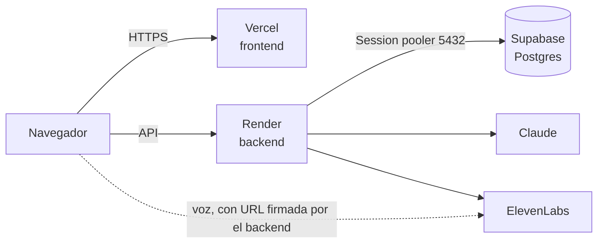

# Despliegue en producción

Tres piezas, cada una en su sitio:

| Pieza | Dónde | Por qué ahí |
|---|---|---|
| Frontend (Next.js) | **Vercel** | Lo construye y publica solo con cada cambio en `main`, con HTTPS y CDN |
| Backend (FastAPI) | **Render** (`render.yaml`) | Necesita un proceso siempre encendido: procesa cada turno en segundo plano tras responder y espera varios segundos a Claude. Las funciones de Vercel se apagan al terminar la respuesta |
| Base de datos | **Supabase** (Postgres) | Guarda perfiles, versiones y sesiones. El esquema bloquea modificar o borrar versiones |

Las claves de Claude, ElevenLabs y la contraseña de Supabase viven **solo** en el panel de Render. El
navegador nunca las ve. Ningún secreto se escribe en el repositorio.

## Qué cambia respecto a local

- **Topes de gasto** (`backend/app/limites.py`): `LIMITE_SESIONES_DIA` (30), `LIMITE_VOZ_DIA` (10) y
  `LIMITE_TURNOS_SESION` (60). Al llegar al tope, la app lo dice y sigue dejando ver la demo guiada. Se
  reinician cada día (UTC) y al reiniciar el servidor.
- **«Validar perfil» deshabilitado** y **sin MCP de demostración**: los dos modos de demostración solo
  funcionan en local, a propósito. La validación y Claude + MyInvestor se enseñan desde el portátil.
- **Vista de la entidad**: enseña la Carmen fija y ficticia (DATOS SIMULADOS), sin poder validarla.

## Pasos

### 1. Supabase: aplicar el esquema (una vez, desde tu portátil)

1. En Supabase: **Connect → Session pooler**. Copia la cadena `postgresql://postgres.<ref>:<contraseña>@<host>:5432/postgres`.
   El pooler es necesario porque Render solo sale por IPv4 y la conexión directa de Supabase es IPv6.
2. Pégala en tu `.env` local como `DATABASE_URL=...` (nunca en un chat ni en un commit).
3. Desde `backend/`, sigue los pasos 1 a 6 de [`backend/migraciones/README.md`](../backend/migraciones/README.md):
   comprobación previa, ensayo (no cambia nada), plan, aplicar, verificación y repetición.
   Cada comando lleva el destino explícito, para no tocar nunca otra base por error; con el pooler del equipo:
   `--env-file ../.env --destino aws-1-eu-central-1.pooler.supabase.com:5432/postgres`.

Si Supabase ya tenía la `0001`, el plan solo mostrará la `0002` (audio de las pruebas): se aplica con los
mismos pasos. Mientras no se aplique, el backend arranca igual, solo sin audio.

### 2. Render: el backend

1. En Render: **New → Blueprint**, elige el repositorio. Render lee `render.yaml` y propone el servicio `idoneo-backend`.
2. Rellena las variables marcadas para rellenar a mano:
   - `DATABASE_URL`: la misma cadena del Session pooler.
   - `ANTHROPIC_API_KEY`, `ELEVENLABS_API_KEY`, `ELEVENLABS_AGENT_ID`.
   - `CORS_ORIGINS`: de momento `https://example.com`; se corrige en el paso 4.
3. Crea el servicio. Cuando termine, abre `https://<servicio>.onrender.com/api/health`: debe responder `{"status":"ok"}`.

`CLIENT_ACCESS_SECRET`, `ADMIN_TOKEN` y `VOICE_USER_ID_SECRET` los genera Render. El plan gratuito se duerme
tras 15 minutos sin uso y tarda cerca de un minuto en despertar; el plan Starter no se duerme.

### 3. Vercel: el frontend

1. En Vercel: **Add New → Project**, importa el repositorio.
2. **Root Directory**: `frontend`. Vercel detecta Next.js solo.
3. Variable de entorno: `NEXT_PUBLIC_API_URL` = `https://<servicio>.onrender.com` (sin barra final).
   No añadas `DEMO_ADVISOR_MODE`, `DEMO_ADVISOR_TOKEN` ni ninguna clave de proveedor.
   - **Opcional, administración de la entidad** (`/admin`): para validar perfiles desde la web, añade
     `ADMIN_LOGIN_CLAVE` (clave del equipo, 12 caracteres o más, distinta de `ADMIN_TOKEN`) y `ADMIN_TOKEN`
     (el mismo valor que en Render). Ninguna lleva `NEXT_PUBLIC_`: solo las lee el servidor de Next. Quien
     entre en `/admin` con esa clave puede validar cualquier perfil como `asesor-web`. Para apagarlo,
     borra `ADMIN_LOGIN_CLAVE` y vuelve a desplegar.
   - **Trampa del plan gratuito de Vercel:** solo despliega commits de miembros del proyecto. Si fusiona
     otra persona, el despliegue sale «Deployment was blocked» y la web se queda en la versión anterior
     (Render sí despliega). Solución: que la última fusión en `main` la haga el dueño del proyecto de Vercel.
4. **Deploy**. Apunta la URL de producción (`https://<proyecto>.vercel.app`).

### 4. Conectar las dos piezas

1. En Render, cambia `CORS_ORIGINS` por la URL de Vercel (sin barra final) y guarda: se vuelve a desplegar.
   Así el backend solo acepta peticiones del navegador que vengan de vuestro frontend.
2. Si el agente de ElevenLabs tiene lista de dominios permitidos, añade el de Vercel.
3. Pruebas de audio (opcional, el navegador ya avisa al colgar): en ElevenLabs, activa el webhook
   *post-call transcription* hacia `https://<servicio>.onrender.com/api/webhooks/elevenlabs` y copia su
   secreto en Render como `ELEVENLABS_WEBHOOK_SECRET`. Así el audio se descarga aunque el cliente cierre la
   pestaña antes de colgar. Detalle en [pruebas-de-audio.md](pruebas-de-audio.md).

### 5. Comprobar

| Abre | Debe pasar |
|---|---|
| `https://<proyecto>.vercel.app` | Portada con el aura |
| `/escenario` → **Ver la demo guiada** | La entrevista de Carmen y su perfil en directo (no gasta créditos) |
| `/entidad/carmen-68` | El perfil de Carmen, con «Validar perfil» deshabilitado |
| `/onboarding/entrevista` → **Escribir** | Una entrevista real por texto con Claude |
| `/onboarding/entrevista` → **Hablar** | La entrevista por voz con ElevenLabs |

Si algo falla, los **Logs** de Render muestran el error del backend. Un error de CORS en la consola del
navegador casi siempre es `CORS_ORIGINS` mal escrito.
