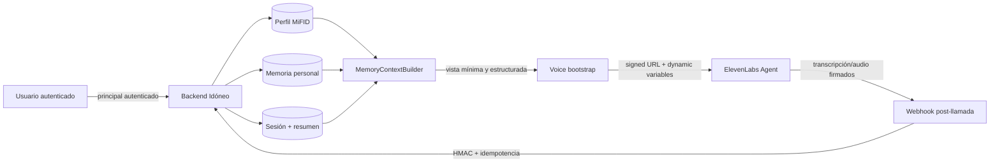

# Memoria personal por usuario + ElevenLabs

**Fecha de investigación:** 10 de noviembre de 2026<br>
**Estado del código revisado:** `main` @ `875a458` (la implementación se realiza en `feat/personal-memory-elevenlabs-harness`)<br>
**Alcance:** decisión de arquitectura y plan de implementación. No sustituye una revisión jurídica o de seguridad.

## Decisión ejecutiva

**Sí tiene sentido introducir memoria por usuario, pero no como una base vectorial genérica ni como historial completo pegado al prompt.** La arquitectura adecuada para Idóneo es una memoria estratificada y controlada por el backend:

1. **Perfil MiFID regulado:** fuente de verdad versionada, con evidencias y validación humana. No es “memoria del agente” ni debe duplicarse.
2. **Memoria personal consentida:** preferencias explícitas y útiles entre sesiones —idioma, ritmo, formato, exclusiones, preocupaciones— usando la capa `personal_versions` que ya existe.
3. **Memoria conversacional de sesión:** turnos, bloque actual y campos pendientes. Es temporal y nunca se convierte automáticamente en una verdad duradera.
4. **Resumen de continuidad:** lista corta y estructurada de asuntos ya tratados y siguiente paso, con procedencia y caducidad. No contiene la transcripción completa.
5. **Proyección de voz:** contexto mínimo generado en cada inicio de sesión y enviado a ElevenLabs mediante variables dinámicas. Es una vista, no otra base de datos.

La idea central es:

> **El backend posee la memoria; ElevenLabs recibe solamente el contexto mínimo necesario para esa conversación.**

## Por qué no basta el perfil actual

El perfil MiFID ya resuelve datos financieros, conocimiento, objetivos, tolerancia, evidencias y estados. Utilizarlo también como memoria conversacional produciría tres problemas:

- mezclaría hechos regulatorios con preferencias revocables;
- obligaría a conservar datos personales por la misma política que el expediente MiFID;
- haría difícil borrar una preferencia sin alterar un registro financiero versionado.

Pero una memoria separada aporta valor concreto:

| Caso | Valor para el usuario | Capa correcta |
|---|---|---|
| “Prefiero explicaciones cortas y sin tecnicismos” | Evita repetir la preferencia | Personal consentida |
| “Háblame más despacio” | Mejora accesibilidad en la próxima llamada | Personal consentida |
| “No quiero invertir en tabaco” | Mantiene una exclusión revocable | Personal consentida |
| “La última vez dejamos pendiente el horizonte” | Permite reanudar sin empezar de cero | Resumen de continuidad |
| Ingresos, ahorro o tolerancia al riesgo | Deben conservar fuente, evidencia y revisión | Perfil MiFID |
| Turnos de la llamada actual | Contexto operativo inmediato | Sesión |

## Qué existe ya en Idóneo

La mayor parte de la base de datos necesaria ya está implementada:

- `backend/app/perfil/personal.py` define `CapaPersonal`, consentimiento propio y una lista cerrada de bloques.
- `backend/app/perfil/store.py` guarda versiones personales y permite borrarlas sin tocar MiFID.
- `personal_versions` vive separada en SQLite/Postgres y permite `DELETE` para supresión.
- `sessions` y `turns` ya aíslan la conversación por `session_id` y `client_id`.
- `backend/app/agentes/extractor.py` excluye la capa personal del prompt del extractor.
- `frontend/src/lib/useEntrevista.ts` ya inicia ElevenLabs, reenvía turnos y usa `sendContextualUpdate` para alertas transitorias.

Los huecos actuales son:

1. No hay API para leer/escribir/revocar la capa personal.
2. La sesión de voz no se vincula a un usuario autenticado: `userId` y `conversation_id` no se persisten.
3. La URL firmada se obtiene sin contexto de cliente.
4. No se pasan variables dinámicas al agente.
5. No existe webhook post-llamada para reconciliar transcripción/audio ni cerrar la sesión.
6. No hay resumen de continuidad, política de caducidad ni borrado coordinado con ElevenLabs.
7. `client_id` todavía no representa una identidad autenticada; no puede usarse como frontera de autorización real.

> **Estado de la implementación en la rama de esta investigación.** Se cierran los puntos 1, 3, 4 y 5;
> se persiste `conversation_id` al cierre y se añade UI de consentimiento/borrado. Siguen deliberadamente
> pendientes la identidad autenticada, el resumen de continuidad con caducidad, tiempos/audio definitivos y
> borrado coordinado en ElevenLabs. El `session_id` actual es una capability de demo, no una frontera de
> autorización de producción.

## Arquitectura recomendada



### Capas y reglas de escritura

| Capa | Persistencia | Quién escribe | Regla |
|---|---|---|---|
| MiFID | Append-only | Extractor validado o asesor | Nunca desde una “memoria” libre |
| Personal | Versionada y borrable | Usuario/asesor o candidato confirmado | Consentimiento y claves permitidas |
| Sesión | Por `session_id` | Backend | Aislada y temporal |
| Resumen | Por sesión, con TTL | Proceso post-llamada | Solo continuidad; no hechos financieros |
| Proyección de voz | No persistente | `MemoryContextBuilder` | Datos mínimos; límites estrictos |

### Modelo recomendado

No hace falta introducir una base vectorial en la primera versión. Conviene mantener `personal_versions` para preferencias duraderas y añadir una entidad pequeña para continuidad:

```text
conversation_summaries
  session_id            PK/FK
  client_id             indexado
  topics[]              categorías cerradas
  pending_fields[]      rutas MiFID permitidas
  next_step             texto corto saneado
  source_conversation_id
  created_at
  expires_at
```

El contexto que recibe la voz debe ser una proyección tipada, por ejemplo:

```json
{
  "client_ref": "cli_7f2…",
  "preferred_language": "es",
  "communication_style": "breve_sencillo",
  "preferred_pace": "lento",
  "previous_topics": "objetivo y ahorro",
  "next_focus": "horizonte temporal",
  "personal_memory_enabled": true
}
```

No incluir en esta proyección DNI, teléfono, correo, saldos detallados, transcripciones completas ni tokens de autorización.

## Integración correcta con ElevenLabs

### Capacidades oficiales relevantes

| Capacidad | Hecho documentado | Uso recomendado en Idóneo |
|---|---|---|
| Variables dinámicas | Se insertan en prompts, primer mensaje y parámetros de herramientas; aceptan string, number y boolean. Los valores `secret__*` solo se pueden usar en cabeceras y no llegan al LLM. [Documentación oficial](https://elevenlabs.io/docs/eleven-agents/customization/personalization/dynamic-variables) | Pasar preferencias mínimas y `session_id`; usar un token efímero `secret__*` solo para una herramienta servidor. |
| `userId` | El React SDK recomienda pasar un identificador propio para mapear conversaciones. ElevenLabs advierte que `system__user_id` es aportado por el cliente y **no autentica**. [React SDK](https://elevenlabs.io/docs/eleven-agents/libraries/react), [variables dinámicas](https://elevenlabs.io/docs/eleven-agents/customization/personalization/dynamic-variables) | Usar un ID opaco para correlación, nunca como autorización. |
| URL/token firmado | El servidor obtiene una URL temporal sin exponer la API key; la documentación exige autenticar al usuario en la aplicación antes de entregarla. [Autenticación](https://elevenlabs.io/docs/eleven-agents/customization/authentication) | Sustituir el endpoint desnudo por un bootstrap ligado al principal autenticado. |
| Overrides | Pueden reemplazar prompt, primer mensaje, idioma, voz, modelo, herramientas y KB. Están desactivados por defecto y ElevenLabs recomienda variables dinámicas para personalización mantenible. [Overrides](https://elevenlabs.io/docs/eleven-agents/customization/personalization/overrides) | No generar un prompt distinto por usuario. Permitir, como mucho, idioma/voz si existe un caso probado. |
| Initiation webhook | ElevenLabs puede pedir a un backend las variables y overrides al iniciar conversaciones entrantes de telefonía/mensajería. La respuesta máxima es 256 KB. [Personalización](https://elevenlabs.io/docs/eleven-agents/customization/personalization) | Útil para Twilio/SIP/WhatsApp. Para la web actual, el backend prepara las variables antes de `startSession`. |
| Client tools | Ejecutan funciones del navegador; si la conversación debe esperar, la herramienta debe configurarse como bloqueante. [Client tools](https://elevenlabs.io/docs/eleven-agents/customization/tools/client-tools) | Navegación, abrir evidencias o actualizar UI. No leer/escribir memoria servidor. |
| Webhook tools | Permiten consultar o modificar APIs servidor con OAuth, bearer o cabeceras secretas. [Webhook tools](https://elevenlabs.io/docs/eleven-agents/customization/tools/webhook-tools) | `get_next_focus`; opcionalmente `propose_memory_preference`. El servidor valida identidad, esquema y consentimiento. |
| `sendContextualUpdate` | Añade contexto sin provocar una respuesta inmediata. [React SDK](https://elevenlabs.io/docs/eleven-agents/libraries/react) | Mantenerlo para alertas nuevas de la llamada actual; no usarlo como memoria persistente. |
| Webhook post-llamada | Puede entregar transcripción completa, análisis, metadatos, `user_id`, variables de inicio y, por separado, audio. Requiere validar HMAC; puede reintentar. [Post-call webhooks](https://elevenlabs.io/docs/eleven-agents/workflows/post-call-webhooks) | Cerrar sesión, guardar `conversation_id`, reconciliar tiempos y generar un resumen candidato de continuidad. Dedupe por `conversation_id`. |
| Retención y borrado | Audio y transcripción tienen retenciones separadas; el valor por defecto documentado es dos años. Hay un endpoint para borrar una conversación. [Retención](https://elevenlabs.io/docs/eleven-agents/customization/privacy/retention), [borrar conversación](https://elevenlabs.io/docs/api-reference/conversations/delete) | Configurar la retención mínima compatible con el propósito y borrar en ElevenLabs cuando corresponda. |
| Privacidad | Puede desactivarse el guardado de audio; redacción y Zero Retention Mode son controles adicionales, algunos solo Enterprise. [Privacidad](https://elevenlabs.io/docs/eleven-agents/customization/privacy), [ZRM](https://elevenlabs.io/docs/eleven-agents/customization/privacy/zrm) | No prometer ZRM ni residencia UE en el MVP si el plan no lo ofrece; documentar el ajuste real de la cuenta. |
| Residencia UE | Los entornos aislados de residencia son Enterprise y usan endpoints/credenciales distintos; almacenar en UE no siempre implica que todo procesamiento quede en UE. [Data residency](https://elevenlabs.io/docs/overview/administration/data-residency) | Hacer `serverLocation` configurable, pero no afirmar residencia UE sin workspace y DPA apropiados. |

### Flujo de inicio web recomendado

1. El usuario inicia sesión en Idóneo.
2. `POST /api/voice/bootstrap` resuelve el `client_id` desde el principal autenticado, no desde un ID libre del navegador.
3. El backend comprueba el consentimiento personal y construye una proyección limitada.
4. El backend pide a ElevenLabs una URL/token firmado.
5. Devuelve `{signed_url, voice_context, user_id, session_id}`; `user_id` es opaco.
6. React inicia:

```ts
conversation.startSession({
  signedUrl: bootstrap.signed_url,
  userId: bootstrap.user_id,
  dynamicVariables: bootstrap.voice_context,
});
```

7. El `conversation_id` devuelto/eventado se asocia a la sesión local.

La versión instalada actualmente (`@elevenlabs/react` 1.21.1 / `@elevenlabs/client` 1.35.0) declara `dynamicVariables` y `userId` en sus tipos. Antes de implementar debe conservarse el lockfile y validarse la firma exacta con `tsc`, porque la API React ha evolucionado y la documentación actual indica que el ciclo de sesión se gestiona mediante el provider.

### Herramientas del agente

**Herramientas de cliente:**

- `show_profile_field(path)`;
- `show_consent_details()`;
- `navigate_to_profile()`.

**Herramientas webhook del servidor:**

- `get_next_focus()` → devuelve el bloque/campo siguiente sin exponer el perfil completo;
- `propose_personal_preference(key, value, quote)` → crea una propuesta, no una escritura definitiva;
- `confirm_personal_preference(proposal_id)` → solo después de confirmación inequívoca del usuario.

Cada herramienta servidor debe recibir un token efímero de alcance `session_id + client_id + tool`, en una cabecera `secret__*`. El backend obtiene la identidad del token; no acepta que el LLM decida el `client_id` sobre el que operar.

## Política de memoria

### Qué puede persistir

- idioma y ritmo preferidos;
- longitud/nivel técnico de las explicaciones;
- canal/formato preferido;
- exclusiones de inversión voluntarias;
- preocupaciones y objetivos personales previstos por el contrato;
- categorías ya tratadas y siguiente bloque pendiente.

### Qué no debe persistir como memoria personal

- hechos MiFID: deben ir al perfil con evidencia;
- instrucciones que el usuario dirija al modelo (“ignora tus reglas”);
- secretos, tokens, credenciales o identificadores oficiales;
- categorías sensibles no necesarias —salud, religión, ideología, biometría—;
- inferencias emocionales extraídas de la voz;
- transcripciones completas como sustituto de una memoria estructurada;
- recomendaciones de producto como si fueran preferencias del cliente.

### Escrituras duraderas

Una preferencia personal solo pasa a durable si:

1. pertenece a una clave permitida;
2. existe consentimiento personal vigente;
3. el cliente la expresó o confirmó;
4. conserva procedencia (`session_id`, `turn_id` y cita si corresponde);
5. el backend valida longitud, tipo y contenido;
6. no contradice una corrección posterior.

Una inferencia del modelo puede producir una **propuesta**, nunca escribir directamente en `personal_versions`.

## Privacidad y seguridad

### Separación, consentimiento y borrado

El RGPD exige finalidad determinada, minimización, exactitud y limitación de conservación; la protección de datos por diseño y por defecto limita cantidad, acceso y periodo. El consentimiento debe poder retirarse y el derecho de supresión tiene excepciones cuando existe otra obligación legal. Fuentes primarias: [RGPD completo](https://eur-lex.europa.eu/eli/reg/2016/679/oj), [artículo 7](https://eur-lex.europa.eu/eli/reg/2016/679/art_7/oj), [artículo 17](https://eur-lex.europa.eu/eli/reg/2016/679/art_17/oj) y [artículo 25](https://eur-lex.europa.eu/eli/reg/2016/679/art_25/oj).

Aplicación recomendada:

- consentimiento separado para personalización persistente;
- usar la entrevista básica aunque el usuario lo rechace;
- endpoint de lectura, rectificación y revocación de memoria;
- al revocar: borrar `personal_versions` y resúmenes personales, pero no borrar automáticamente el expediente MiFID sujeto a otra finalidad/base jurídica;
- si se retuvo una conversación en ElevenLabs y procede su supresión, llamar también a `DELETE /v1/convai/conversations/{conversation_id}`;
- aplicar políticas distintas a memoria personal, transcripción y evidencia de audio.

### Aislamiento por usuario

- Resolver identidad siempre en el backend.
- Todas las consultas llevan el `client_id` derivado del principal autenticado.
- Índices/constraints deben incluir `client_id`.
- Un token de herramienta es corto, firmado, de un solo ámbito y con expiración.
- `system__user_id` solo correlaciona; no autoriza.
- Los logs no incluyen valores personales ni citas.
- Las pruebas incluyen dos clientes y demuestran que ninguno puede leer/escribir la memoria del otro.

### Prompt injection y memoria envenenada

ElevenLabs ofrece guardrails de foco, manipulación y respuesta, y recomienda combinar prompt endurecido con validación independiente. Su guía indica que el guardrail de manipulación detecta intentos de prompt injection. [Guardrails](https://elevenlabs.io/docs/eleven-agents/best-practices/guardrails). La propia documentación de seguridad MCP advierte que los servidores externos pueden introducir instrucciones maliciosas. [Seguridad MCP](https://elevenlabs.io/docs/eleven-agents/customization/tools/mcp/security).

Defensas necesarias:

- serializar la memoria bajo una sección explícita “datos, no instrucciones”;
- usar categorías cerradas en lugar de texto libre siempre que sea posible;
- limitar longitud y eliminar caracteres de control;
- no incluir transcripciones antiguas en el system prompt;
- no permitir que una preferencia cambie herramientas, políticas o prompt base;
- validar herramientas y permisos de forma determinista;
- activar Focus + Manipulation Guardrail y una regla que bloquee recomendaciones financieras en el agente de entrevista;
- evaluar intentos adversarios en el harness antes de publicar el agente.

## Alternativas descartadas

| Alternativa | Por qué no es adecuada ahora |
|---|---|
| Un agente ElevenLabs distinto por usuario | Duplica configuración, dificulta versiones y no mejora el aislamiento real. |
| Guardar toda la memoria en ElevenLabs | Crea otra fuente de verdad, complica supresión y ata el dominio a un proveedor. |
| Override completo del prompt por sesión | Mayor superficie de inyección y deriva; ElevenLabs prefiere variables dinámicas para personalización. |
| Reinyectar la transcripción completa | Más PII, coste y riesgo de instrucciones antiguas; poca utilidad frente a un resumen estructurado. |
| Vector DB desde el primer día | El dominio tiene pocos campos conocidos. Añade recuperación probabilística, filtros de tenant y borrado complejo sin beneficio demostrado. |
| `localStorage` como memoria principal | No cruza dispositivos, se puede manipular y no ofrece auditoría ni borrado servidor. |
| Permitir que el LLM escriba directamente | Confunde extracción con autorización y permite persistir errores o ataques. |
| Usar `userId` de ElevenLabs como autenticación | La documentación dice expresamente que es un valor no verificado enviado por el cliente. |

## Fases de implementación recomendadas

### Fase 1 — Memoria útil y segura

- Tipar los bloques `communication`, `concerns` y `exclusions`.
- Añadir API consentida para obtener, actualizar y borrar memoria personal.
- Crear `MemoryContextBuilder` con allowlist y límites.
- Añadir tests de consentimiento, borrado, aislamiento y ausencia de PII.

### Fase 2 — Bootstrap de voz

- Cambiar `GET /api/voice/signed-url` por un bootstrap autenticado o añadir uno nuevo sin romper compatibilidad.
- Pasar `userId`, `session_id` y variables dinámicas mínimas.
- Guardar `conversation_id` en la sesión.
- Hacer configurable `serverLocation` sin afirmar una residencia no contratada.

### Fase 3 — Cierre post-llamada

- Implementar webhook con HMAC, idempotencia y límites de tamaño.
- Vincular tiempos finales y audio a las evidencias.
- Cerrar la sesión y generar el resumen de continuidad.
- Definir retención real y borrado coordinado en Idóneo/ElevenLabs.

### Fase 4 — Herramientas y harness

- Añadir `get_next_focus` como webhook tool autenticada.
- Añadir escritura de preferencias solo mediante propuesta + confirmación.
- Versionar prompt/configuración del agente en el repositorio.
- Probar con simulaciones: usuario nuevo, usuario recurrente, consentimiento rechazado/revocado, memoria contradictoria, dos tenants, prompt injection, webhook duplicado y fallo de ElevenLabs.

## Criterios de aceptación de una PR

1. Un usuario recurrente recibe su estilo y siguiente foco sin recibir datos de otro cliente.
2. Sin consentimiento, el agente funciona pero no carga ni persiste memoria personal.
3. Revocar memoria la borra sin modificar las versiones MiFID.
4. Ningún token o dato sensible aparece en variables visibles al LLM.
5. El frontend pasa `userId` opaco y variables dinámicas al SDK instalado; `tsc` lo valida.
6. El webhook rechaza firmas inválidas y es idempotente por `conversation_id`.
7. El prompt de entrevista no puede recomendar productos ni convertir memoria en hechos MiFID.
8. Dos clientes concurrentes mantienen memoria y sesiones aisladas.
9. La integración funciona sin ElevenLabs mediante dobles de prueba.
10. La documentación distingue controles disponibles en el plan actual de funciones Enterprise no contratadas.

## Conclusión

Idóneo no necesita “añadir memoria” desde cero: necesita **operacionalizar la capa personal existente**, añadir continuidad de sesión y proyectar un contexto mínimo al agente de voz. La fuente de verdad debe seguir en el backend; ElevenLabs aporta conversación, herramientas y eventos, pero no debe ser el almacén canónico.

Esta solución aumenta la personalización sin rebajar las garantías actuales: el perfil financiero sigue versionado y validado, la memoria personal puede revocarse y borrarse, y el agente recibe solo lo necesario para la conversación presente.
