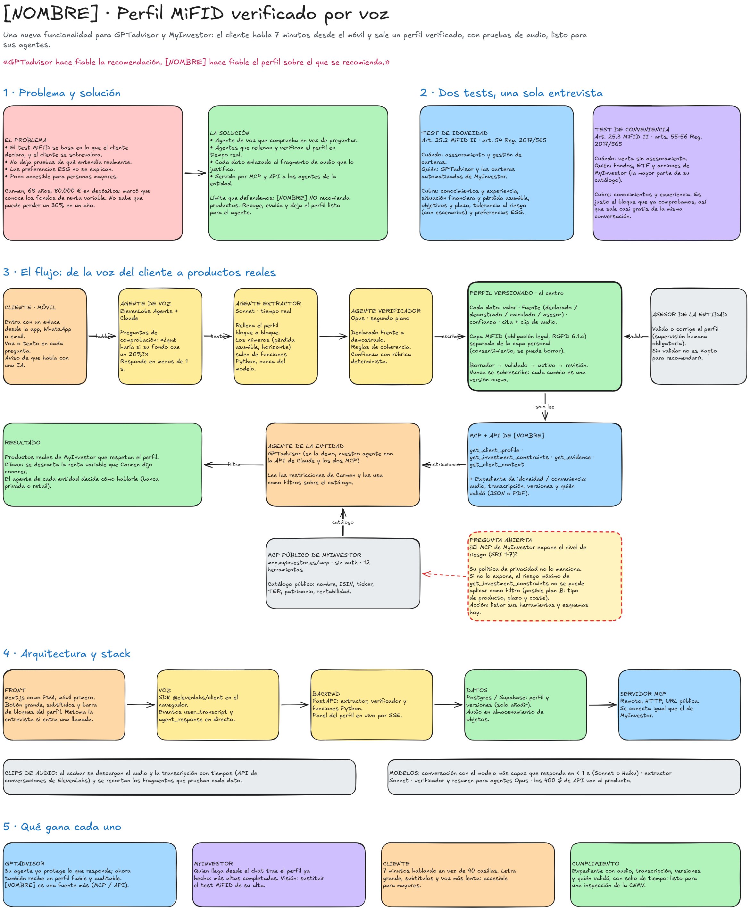

# [NOMBRE] · Documentación del proyecto

Estado a 8 nov 2026. Esta carpeta recoge la idea actual del equipo para Hack Finance UC3M. El nombre "Idóneo" era provisional; hasta tener el definitivo se usa `[NOMBRE]`.

> El resto del repositorio (código, `gestion/` y los otros ficheros de `docs/`) es contenido anterior. De momento no se usa como referencia, pero tampoco se ha borrado.

## La idea en un párrafo

[NOMBRE] es un onboarding por voz, pensado primero para móvil, que convierte el test MiFID en un **perfil de cliente verificado y con pruebas de audio**. Un agente de voz comprueba en vez de preguntar ("¿qué haría si su fondo cae un 20 %?"), unos agentes rellenan y verifican el perfil en tiempo real, y cada dato queda enlazado al fragmento de audio que lo justifica. El perfil se sirve por MCP y API a los agentes de la entidad. **[NOMBRE] solo crea perfiles: no recomienda productos.**

- **Problema:** el test MiFID se basa en lo que el cliente declara, y el cliente se sobrevalora. No deja prueba de qué entendía, no explica bien la ESG y es poco accesible para personas mayores.
- **Dos tests en una entrevista:** el resultado de **idoneidad** sirve para el asesoramiento de GPTadvisor y las carteras automatizadas de MyInvestor; el de **conveniencia**, para la compra sin asesoramiento de fondos, ETF y acciones en MyInvestor.
- **Posicionamiento:** una funcionalidad que da ventaja a GPTadvisor y MyInvestor, no un producto de venta. "GPTadvisor hace fiable la recomendación. [NOMBRE] hace fiable el perfil sobre el que se recomienda."

## Documentos

| Fichero | Qué contiene |
| --- | --- |
| [01_DISENO.md](01_DISENO.md) | Documento de diseño original: marco legal MiFID, onboarding ampliado, experiencia móvil, modelo de perfil, salidas, integración, arquitectura y borrador de demo. Con notas de actualización. |
| [02_AUDITORIA_Y_DECISIONES.md](02_AUDITORIA_Y_DECISIONES.md) | Auditoría de la idea, decisiones tomadas por el equipo y preguntas abiertas. **Prevalece sobre el diseño.** |
| [03_REPARTO_Y_PLAN.md](03_REPARTO_Y_PLAN.md) | Reparto en 6 piezas y calendario de 5 días. |
| [04_CONTRATO_PERFIL.md](04_CONTRATO_PERFIL.md) | Contrato del perfil: modelo de dato, esquema completo, resultados de idoneidad y conveniencia, estados, restricciones, eventos y herramientas MCP/API. |
| [05_MCP_MYINVESTOR.md](05_MCP_MYINVESTOR.md) | Hallazgos verificados del MCP público de MyInvestor: herramientas, campos, mapeo al perfil y **condiciones de uso**. |
| [diagramas/](diagramas/) | Diagrama de la idea final en Excalidraw (`.excalidraw` editable y vista previa `.png`). |

## Decisiones clave

1. El producto **solo crea perfiles**. Asesorar, asignar carteras o avisar de no conveniencia lo hacen los agentes de quien consume el perfil.
2. Cubre **idoneidad y conveniencia**.
3. Equipo de 6, 5 días: **no se recorta alcance**; se ordena (primero la cadena de punta a punta).
4. Funcionalidad para GPTadvisor y MyInvestor; la viabilidad económica pesa poco.
5. El MCP de MyInvestor se usa **como conector en Claude**: sus términos prohíben llamarlo por programa sin permiso.
6. La demo aún no se toca. El nombre definitivo está pendiente.

## Cómo abrir el diagrama

En excalidraw.com, fuera de la sala compartida: Menú → Abrir → `diagramas/idea-final.excalidraw`. Para llevarlo a la sala del equipo sin borrar lo que hay: clic en el lienzo, Ctrl+A, Copiar, y Ctrl+V en la sala.

Ojo: el recuadro rojo del diagrama ("¿expone MyInvestor el nivel de riesgo?") es anterior a la inspección del MCP. Ya está resuelto: sí lo expone para fondos (SRRI 1–7). Ver [05_MCP_MYINVESTOR.md](05_MCP_MYINVESTOR.md).
