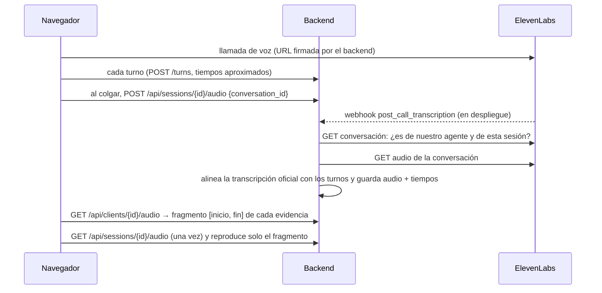

# Pruebas de audio

Cada dato del perfil que sale de una entrevista por voz suena con el fragmento de la llamada en que el
cliente lo dijo. En la vista de la entidad, pestaña **Evidencias**, cada cita tiene un botón ▶.

## Cómo funciona

1. **Al colgar**, el navegador manda el `conversation_id` de la llamada. En despliegue también llega el
   webhook firmado de ElevenLabs. Cualquiera de los dos encola la descarga; si ya está guardado, no se repite.
2. **Se comprueba la propiedad.** El backend descarga la conversación de ElevenLabs y solo la acepta si la
   creó nuestro agente (`ELEVENLABS_AGENT_ID`) con la variable `session_id` de esta sesión. Así nadie puede
   colgar en su perfil el audio de otra persona mandando un identificador ajeno.
3. **Se espera a ElevenLabs.** Tarda de unos segundos a más de un minuto en tener el audio: se reintenta
   seis veces, hasta unos 3 minutos. El estado se ve en `GET /api/sessions/{id}/audio/status`.
4. **Se alinean los tiempos.** La transcripción oficial da el segundo en que empieza cada mensaje. Cada
   turno de la sesión se empareja, en orden, con el mensaje oficial del mismo hablante más parecido. Un
   turno sin pareja conserva los tiempos aproximados del navegador, y su fragmento se marca «aprox.».
5. **Se guarda una vez.** El audio completo de la sesión, los tiempos de cada turno y la transcripción
   oficial van a la tabla `session_audio` (migración 0002), de solo añadir como la transcripción: forma
   parte del expediente.
6. **Se escucha el fragmento.** No se recorta el archivo: el navegador descarga el audio de la sesión una
   vez, con la credencial del cliente, y reproduce solo `[inicio, fin]` con medio segundo de margen.

`GET /api/clients/{id}/evidence/{dato}` y la herramienta MCP `get_evidence` devuelven también el
fragmento de cada evidencia (`audio`: ruta del audio de la sesión, `start`, `end`, `exact`).

## Carmen (demo)

Carmen es ficticia y no tiene una llamada real. Sus evidencias suenan con las frases que se grabaron con
ElevenLabs para la demo guiada (`frontend/public/demo/carmen/`), localizadas por la cita. Funciona también
en la versión desplegada y no gasta créditos.

## Qué hace falta

| Dónde | Qué |
|---|---|
| Backend | `ELEVENLABS_API_KEY` (con permiso de lectura de ElevenAgents) y `ELEVENLABS_AGENT_ID`, las mismas de la voz |
| ElevenLabs | Que el agente guarde el audio de las llamadas (lo hace por defecto). En despliegue, el webhook `post_call_transcription` apuntando a `https://<backend>/api/webhooks/elevenlabs` con `ELEVENLABS_WEBHOOK_SECRET` |
| Postgres / Supabase | La migración `0002_audio_de_sesion.sql` ([procedimiento](../backend/migraciones/README.md)). Sin ella el backend arranca igual, pero sin audio |
| Local con `PERFIL_ALMACEN=memoria` | Nada más: el audio vive en memoria, como las sesiones, y se pierde al reiniciar |

## Límites

- Los tiempos de ElevenLabs van por segundos enteros: el fragmento puede empezar o acabar hasta un segundo
  antes o después de la frase.
- Un audio de más de 30 MB (unos 30 minutos) se rechaza.
- El audio es un dato personal. Se sirve solo con la credencial de esa sesión y nunca va al modelo. Borrarlo
  también en ElevenLabs depende de la retención configurada en su panel.
- En el modo asesor de demostración y en el acceso de administración (`/admin`), la vista de la entidad
  solo puede escuchar el audio de un cliente nuevo desde la pestaña que hizo la entrevista, porque es la
  que tiene su credencial. Carmen suena siempre.
